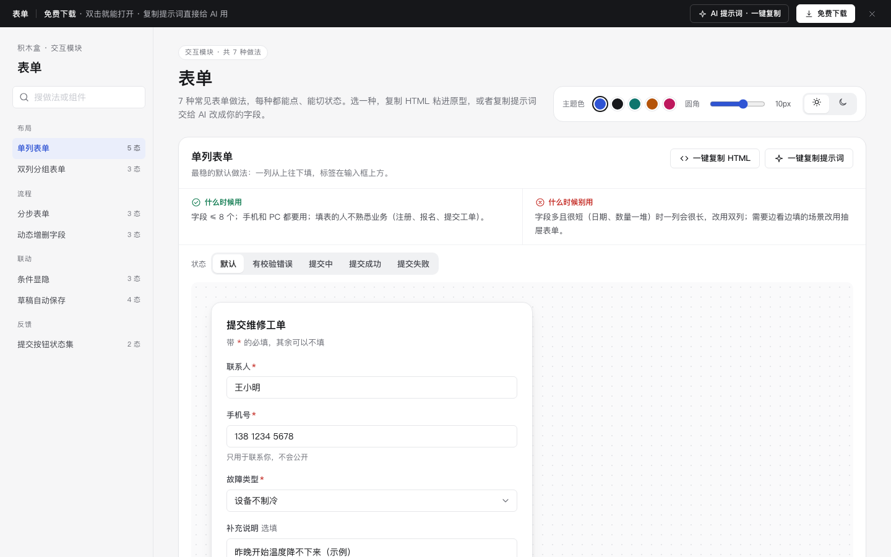

# 表单 · 交互模块

免费下载 · 双击就能打开 · 复制提示词直接给 AI 用。

> 积木盒 · 老岳AI编辑部 · 原型组　|　交互模块（组件 → **模块** → 页面模板）　|　单文件 HTML，离线可用　|　2026-11-10

这是一页能点的表单做法合集：7 种常见做法，每种都能切状态、能真实填写提交。挑一种，复制 HTML 粘进你的原型；或者复制提示词，让 AI 改成你的字段。

---

## 一、用处

| 项 | 说明 |
|---|---|
| 解决什么 | 画表单原型时最容易漏的是**状态**：校验错了长什么样、提交中能不能再点、失败了内容还在不在。这里每种做法把这些状态都摆出来了 |
| 适合谁 | 要画新增 / 编辑 / 申请 / 注册类页面的产品经理；要和研发、测试对齐表单细节的时候 |
| 和页面模板的关系 | 页面模板（如「列表 + 详情抽屉」）是整页；模块是其中一块的多种做法，拼页面时从这里挑 |

## 二、做法清单

| # | 做法 | 状态 | 什么时候用 | 什么时候别用 |
|---|---|---|---|---|
| 1 | 单列表单 | 默认 / 有校验错误 / 提交中 / 提交成功 / 提交失败 | 字段 ≤ 8 个，手机和 PC 都用 | 字段多且短，一列太长 |
| 2 | 双列分组表单 | 标签在上 / 标签在左 / 有校验错误 | PC 后台，8–20 个短字段 | 手机端；字段有先后依赖 |
| 3 | 分步表单 | 第 1 步 / 第 2 步 / 确认页 | 字段 > 15 个或后面取决于前面 | 字段少于 8 个 |
| 4 | 动态增删字段 | 1 行 / 多行 / 达到上限 | 同类信息 1–5 条 | 可能上百条，改用表格 + 导入 |
| 5 | 条件显隐 | 个人 / 企业 / 自提 | 不同类型要填的字段不同 | 一半以上字段要隐藏，直接拆表 |
| 6 | 草稿自动保存 | 已保存 / 保存中 / 有未保存改动 / 恢复草稿 | 要填很久的长表单 | 1 分钟能填完的短表单；敏感内容 |
| 7 | 提交按钮状态集 | 全部状态 / 试一下 | 所有表单的提交按钮 | 别用「按钮不可点」代替校验提示 |

## 三、用法

1. 下载文件夹，双击 `index.html`。
2. 左侧目录点到想要的做法，点「状态」切换看效果，演示区里可以真实填写、提交。
3. 右上角换主题色、圆角、明暗，所有演示实时跟着变。
4. **一键复制 HTML**：复制的是当前状态的 HTML，自带所需的 CSS 变量和样式，粘进任意 HTML 原型就能显示（交互逻辑用下面的提示词让 AI 补）。
5. **一键复制提示词**：每种做法都有一条，交给 AI 就能做出带全部状态的同款。

### 页面上的 AI 提示词

页面顶部「AI 提示词 · 一键复制」里有 3 条，高亮的变量点一下就能就地填写，复制出来就是填好的完整提示词：

| # | 提示词 | 什么时候用 |
|---|---|---|
| 1 | 从零生成整套「表单」交互模块 | 想要一份自己的表单规范 + 演示 |
| 2 | 把表单改成我的业务（变量：做法、业务名称、角色、字段列表、提交后流程） | 已经下载，换成自己的字段 |
| 3 | 在此基础上加一种做法 / 状态（变量：要加的做法、状态清单） | 模块里没有你要的做法 |

## 四、交互说明

| 做法 | 元素 | 交互 | 反馈 |
|---|---|---|---|
| 单列表单 | 提交按钮 | 点击时一次性校验所有必填 | 有错：字段变红 + 写清怎么改，焦点跳到第一个错误；没错：按钮转圈禁用，0.9 秒后出成功页 |
| 单列表单 | 失败提示 | 「重试」 | 已填内容保留，重新提交 |
| 双列表单 | 窄屏 | 宽度 < 700px | 自动变一列；标签在左变标签在上 |
| 分步表单 | 下一步 / 上一步 | 下一步先校验本步；上一步不校验 | 步骤条显示已完成（勾）/ 当前 / 未开始；内容不丢 |
| 分步表单 | 确认页「修改」 | 点击 | 跳回对应步骤，改完再下一步回到确认页 |
| 动态增删 | 添加 / 删除 | 添加后新行自动聚焦；删除 | 删除 Toast 4 秒内可撤销；只剩 1 行时删除置灰；满 5 行时添加置灰并写原因 |
| 条件显隐 | 分段选择 | 选「企业」/「到店自提」 | 字段带下滑动画出现；隐藏字段不校验、不提交；切回来之前填的还在 |
| 草稿保存 | 输入 | 停 1 秒自动保存 | 右上角：有改动未保存 → 保存中 → 已自动保存 + 时间 |
| 草稿保存 | 关闭 | 有未保存改动时 | 先弹确认「仍然关闭 / 继续编辑」 |
| 草稿保存 | 恢复草稿 | 打开时有旧草稿 | 顶部问「恢复 / 丢弃」，不静默覆盖 |
| 提交状态集 | 提交按钮 | 提交中再点 | 不会发第二次请求，提示「请勿重复点击」；可勾选「下一次模拟失败」看失败态 |
| 全页 | 主题色 / 圆角 / 明暗 | 切换 | 所有演示实时变化，记在本机 |

## 五、自检（按《交互设计规范》）

- [x] 每种做法：正常、出错、提交中、成功、失败等状态齐全，可切换
- [x] 每种做法写清「什么时候用 / 什么时候别用」
- [x] 必填最少、选填标明、实时校验、错误文案写「哪里错 + 怎么改」
- [x] 可点元素 ≥ 32px；焦点框清晰；文字对比度 ≥ 4.5:1（浅色、深色都检查）
- [x] 页面上有 3 条 AI 提示词，变量可就地填写，复制有成功反馈
- [x] 无 JS 报错（7 种做法 23 个状态 + 复制 HTML / 提示词 + 明暗切换脚本走查）
- [x] 示例数据标「示例」，无真实公司名

---

本模块由老岳AI编辑部·原型组制作，免费下载、修改、用于工作项目。
