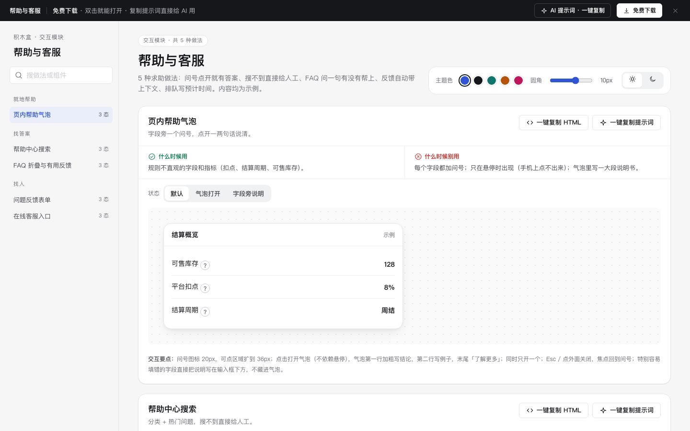

# 帮助与客服 · 交互模块

免费下载 · 双击就能打开 · 复制提示词直接给 AI 用。

> 积木盒 · 老岳AI编辑部 · 原型组　|　交互模块（组件 → **模块** → 页面模板）　|　单文件 HTML，离线可用　|　2026-11-10

这是一页能点的「帮助与客服」做法合集：5 种做法 15 个状态，每种都能切状态、能真实操作。5 种求助做法：问号点开就有答案、搜不到直接给人工、FAQ 问一句有没有帮上、反馈自动带上下文、排队写预计时间。内容均为示例。 挑一种，复制 HTML 粘进你的原型；或者复制提示词，让 AI 改成你的业务。

---

## 一、用处

| 项 | 说明 |
|---|---|
| 解决什么 | 求助路径最常见的坑：问号只能悬停（手机点不出来）、帮助中心搜不到就到头了、FAQ 只问有没有帮助不给人工、反馈要用户自己填页面和版本、排队不说等多久、下班后客服入口消失 |
| 适合谁 | 要画 SaaS 后台、商家端、App 的帮助中心和客服入口的产品经理 |
| 和页面模板的关系 | 页面模板是整页；模块是其中一块的多种做法（任何页面加帮助入口时从这里挑） |

## 二、做法清单

| # | 做法 | 状态 | 什么时候用 | 什么时候别用 |
|---|---|---|---|---|
| 1 | 页内帮助气泡 | 默认 / 气泡打开 / 字段旁说明 | 规则不直观的字段和指标（扣点、结算周期、可售库存）。 | 每个字段都加问号；只在悬停时出现（手机上点不出来）；气泡里写一大段说明书。 |
| 2 | 帮助中心搜索 | 首页 / 搜索结果 / 没找到 | 问题多于 20 个的产品；客服重复回答同样问题时。 | 帮助中心只有目录没有搜索；搜不到只写「无结果」，不给联系客服的入口；把客服入口藏到最底下。 |
| 3 | FAQ 折叠与有用反馈 | 收起 / 展开一条 / 没帮上忙 | 帮助中心文章页、产品介绍页底部、订单页的常见问题。 | 全部展开成一长页；只问「有帮助吗」不收原因；答案里只写「请联系客服」。 |
| 4 | 问题反馈表单 | 填写中 / 提交中 / 已提交 | 遇到 bug、提建议、需要客服跟进但不急的问题。 | 让用户自己填「出问题的页面」「版本号」「账号」；提交后只写「感谢反馈」没有下文；必须上传截图。 |
| 5 | 在线客服入口 | 在线 / 排队中 / 非工作时间 | 急事需要马上找到人的场景（支付、发货、账号）。 | 客服按钮藏三层；排队只写「排队中」不说等多久；下班时间入口直接消失或点了没反应；必须一直开着页面等。 |

## 三、用法

1. 下载文件夹，双击 `index.html`。
2. 左侧目录点到想要的做法，点「状态」切换，演示区里可以真实操作。
3. 右上角换主题色、圆角、明暗，所有演示实时跟着变。
4. **一键复制 HTML**：复制当前状态的 HTML，自带所需 CSS 变量和样式，粘进任意 HTML 原型就能显示（交互逻辑用提示词让 AI 补）。
5. **一键复制提示词**：每种做法一条，交给 AI 就能做出带全部状态的同款。

### 页面上的 AI 提示词

页面顶部「AI 提示词 · 一键复制」里有 3 条，高亮变量点一下就能填，复制出来就是填好的完整提示词：

| # | 提示词 | 什么时候用 |
|---|---|---|
| 1 | 从零生成整套「帮助与客服」交互模块 | 想要一份自己的帮助与客服规范 + 演示 |
| 2 | 把帮助与客服改成我的产品（变量：产品名称、问题清单、规则、信息清单、时效） | 已下载，换成自己的数据和规则 |
| 3 | 在此基础上加一种做法 / 状态（变量：要加的做法、状态清单） | 模块里没有你要的做法 |

## 四、交互说明

| 做法 | 元素 → 交互 → 反馈 |
|---|---|
| 页内帮助气泡 | 问号图标 20px，可点区域扩到 36px；点击打开气泡（不依赖悬停），气泡第一行加粗写结论，第二行写例子，末尾「了解更多」；同时只开一个；Esc / 点外面关闭，焦点回到问号；特别容易填错的字段直接把说明写在输入框下方，不藏进气泡。 |
| 帮助中心搜索 | 首页：大搜索框 + 6 个分类 + 5 个热门问题；输入停 0.2 秒出结果，命中字高亮，每条写所属分类；没找到：写「没找到相关答案」+「联系在线客服」「提交问题反馈」两个按钮，把用户输入带过去不用重打。 |
| FAQ 折叠与有用反馈 | 点问题展开答案（箭头翻转），同时收起其他条；答案末尾「这条有帮助吗？有 / 没有」；选「有」→ 「谢谢反馈」；选「没有」→ 出现原因标签（看不懂 / 没解决我的问题 / 步骤不对）+「转人工客服」，选完原因自动提交。 |
| 问题反馈表单 | 问题类型点选（功能出错 / 用不明白 / 建议 / 其他），默认「功能出错」；描述 10–500 字，下方字数实时；自动附带的信息灰底展示（当前页面、版本、店铺编号、时间），可取消勾选；截图选填；提交中按钮转圈；提交后写工单号、「1 个工作日内回复」、回复会通过站内消息通知。 |
| 在线客服入口 | 右下角常驻「联系客服」按钮；在线：写「平均 1 分钟内回复」，点了直接进对话；排队：写「前面还有 3 人，预计等 4 分钟」，进度条随排队推进，可「先去忙，轮到我时通知我」；非工作时间：写「客服工作时间：工作日 9:00–18:00」，给留言表单，「明天 9:00 后回复」。 |

## 五、自检（按《交互设计规范》）

- [x] 每种做法的状态齐全，可切换，能真实操作
- [x] 每种做法写清「什么时候用 / 什么时候别用」
- [x] 帮助气泡点击打开，不依赖悬停；Esc / 点外面关闭，焦点回到问号
- [x] 从任何地方到人工客服 ≤ 3 步，搜不到、没帮上时直接给人工入口
- [x] 反馈自动带页面、版本、账号信息，不让用户手填
- [x] 排队写前面几人和预计等待，不做跳秒倒计时；下班可留言
- [x] 可点元素 ≥ 32px；焦点框清晰；对比度 ≥ 4.5:1
- [x] 弹窗：Esc / 点遮罩关闭、焦点锁定、关闭后焦点回到触发处
- [x] 页面上有 3 条 AI 提示词，变量可就地填写，复制有成功反馈
- [x] 无 JS 报错（5 种做法 15 个状态自测 OK + 关键交互走查）
- [x] 示例数据标「示例」，无真实公司名和品牌

---

本模块由老岳AI编辑部·原型组制作，免费下载、修改、用于工作项目。
