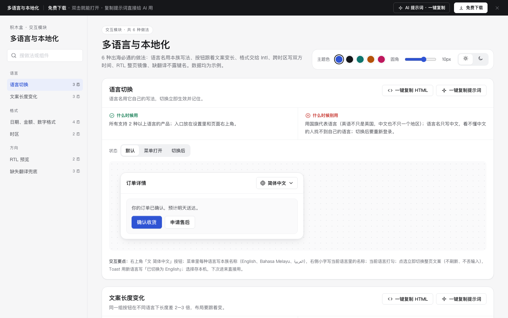

# 多语言与本地化 · 交互模块

免费下载 · 双击就能打开 · 复制提示词直接给 AI 用。

> 积木盒 · 老岳AI编辑部 · 原型组　|　交互模块（组件 → **模块** → 页面模板）　|　单文件 HTML，离线可用　|　2026-11-10

这是一页能点的「多语言与本地化」做法合集：6 种做法 17 个状态，每种都能切状态、能真实操作。6 种出海必遇的做法：语言名用本族写法、按钮跟着文案变长、格式交给 Intl、跨时区写双方时间、RTL 整页镜像、缺翻译不露键名。数据均为示例。 挑一种，复制 HTML 粘进你的原型；或者复制提示词，让 AI 改成你的业务。

---

## 一、用处

| 项 | 说明 |
|---|---|
| 解决什么 | 出海时最常见的坑：用国旗代表语言、语言名只写中文、按钮写死宽度德文被截断、手拼货币符号和日期、跨时区只写一个时间、RTL 只右对齐不镜像、缺翻译直接露出键名 |
| 适合谁 | 要做出海、东南亚多语言、跨境 B2B 产品的产品经理 |
| 和页面模板的关系 | 页面模板是整页；模块是其中一块的多种做法（任何页面模板加多语言时从这里挑） |

## 二、做法清单

| # | 做法 | 状态 | 什么时候用 | 什么时候别用 |
|---|---|---|---|---|
| 1 | 语言切换 | 默认 / 菜单打开 / 切换后 | 所有支持 2 种以上语言的产品；入口放在设置里和页面右上角。 | 用国旗代表语言（英语不只是英国，中文也不只一个地区）；语言名只写中文，看不懂中文的人找不到自己的语言；切换后要重新登录。 |
| 2 | 文案长度变化 | 中文 / 英文 / 德文（最长） | 所有多语言界面；设计稿至少用最长的语言（常见是德语、马来语）检查一遍。 | 按钮、标签、表头写死宽度；用中文排好就上线；为了放得下把译文硬缩成看不懂的缩写。 |
| 3 | 日期、金额、数字格式 | 中国 / 美国 / 德国 / 新加坡 | 任何显示日期、金额、数字的地方，只要用户不止一个地区。 | 手拼「¥」+ 数字；日期写成 11/10/2026 不说是月日还是日月；金额用浮点数直接显示（1234567.891）。 |
| 4 | 时区 | 同时区 / 跨时区 | 跨国会议、跨境配送截单时间、海外客服工作时间、活动开始时间。 | 只写「10:00」不说哪个时区；写「GMT+8」让人自己换算；跨天了不提示（对方那边已经是第二天）。 |
| 5 | RTL 预览 | 从左到右 / 从右到左 | 支持阿拉伯语、希伯来语、波斯语、乌尔都语的产品。 | 只把文字右对齐、布局不镜像；把所有图标都翻转（播放、对勾、品牌标志不该翻）；数字和电话号码也倒过来。 |
| 6 | 缺失翻译兜底 | 完整 / 有缺失 / 键名泄漏（反例） | 所有多语言产品；翻译总会比开发慢一步。 | 直接显示 order.btn.confirm 这种键名；缺翻译时整块不显示；回退到中文给不懂中文的用户看。 |

## 三、用法

1. 下载文件夹，双击 `index.html`。
2. 左侧目录点到想要的做法，点「状态」切换，演示区里可以真实操作。
3. 右上角换主题色、圆角、明暗，所有演示实时跟着变。
4. **一键复制 HTML**：复制当前状态的 HTML，自带所需 CSS 变量和样式，粘进任意 HTML 原型就能显示（交互逻辑用提示词让 AI 补）。
5. **一键复制提示词**：每种做法一条，交给 AI 就能做出带全部状态的同款。

### 页面上的 AI 提示词

页面顶部「AI 提示词 · 一键复制」里有 3 条，高亮变量点一下就能填，复制出来就是填好的完整提示词：

| # | 提示词 | 什么时候用 |
|---|---|---|
| 1 | 从零生成整套「多语言与本地化」交互模块 | 想要一份自己的多语言与本地化规范 + 演示 |
| 2 | 把多语言与本地化改成我的产品（变量：产品名称、语言清单、地区清单、规则、文案清单） | 已下载，换成自己的数据和规则 |
| 3 | 在此基础上加一种做法 / 状态（变量：要加的做法、状态清单） | 模块里没有你要的做法 |

## 四、交互说明

| 做法 | 元素 → 交互 → 反馈 |
|---|---|
| 语言切换 | 右上角「文 简体中文」按钮；菜单里每种语言写本族名称（English、Bahasa Melayu、العربية），右侧小字写当前语言里的名称；当前语言打勾；点选立即切换整页文案（不刷新、不丢输入），Toast 用新语言写「已切换为 English」；选择存本机，下次进来直接用。 |
| 文案长度变化 | 按钮宽度随文字（min-width 而不是 width），一行放不下自动换行到下一行；表格表头放不下时省略号截断，悬停显示全文（title）；下方对比：写死 96px 宽的按钮在德文下被截断（错误做法），自适应宽度的按钮完整显示（正确做法）。经验值：英文比中文长约 1.5–2 倍，德文 / 马来文再长 30%。 |
| 日期、金额、数字格式 | 同一笔示例数据（2026-11-10 02:30 UTC、金额 1234567.891）按地区显示：日期顺序、月份写法、12 / 24 小时制、千分位符号（, . 空格）、小数点、货币符号位置都不同；全部由 Intl.DateTimeFormat / NumberFormat / RelativeTimeFormat 按地区代码算出，代码里不手拼；地区跟用户设置走，不跟语言走。 |
| 时区 | 同时区只写一个时间；跨时区并排两张卡：「你的时间（新加坡）」「对方时间（纽约）」，时间大字、日期小字，对方日期和你不同时用黄字写「前一天 / 次日」；时区用城市名而不是 UTC 偏移；全部由 Intl 按时区算出。 |
| RTL 预览 | 容器加 dir="rtl"：布局用逻辑属性（margin-inline-start、text-align:start），自动整页镜像——返回按钮到右边、头像到右边、箭头指向左；只翻转表示方向的图标（返回、前进、列表箭头），不翻转对勾、搜索、播放；数字、金额、手机号保持从左到右。 |
| 缺失翻译兜底 | 回退顺序：当前语言 → 英文 → 中文；在测试 / 预览环境，回退出来的文案加黄底并悬停显示「缺少马来文翻译：order.btn.after」，方便翻译补齐；正式环境不加标记；反例：直接把键名显示给用户。 |

## 五、自检（按《交互设计规范》）

- [x] 每种做法的状态齐全，可切换，能真实操作
- [x] 每种做法写清「什么时候用 / 什么时候别用」
- [x] 日期、金额、数字、相对时间全部由 Intl 接口按地区计算，不手拼
- [x] 语言名用本族写法，不用国旗；切换立即生效并记住
- [x] 布局用逻辑属性，dir="rtl" 时自动镜像，只翻转方向类图标
- [x] 缺翻译按 当前语言 → 英文 → 中文 回退，绝不显示键名
- [x] 可点元素 ≥ 32px；焦点框清晰；对比度 ≥ 4.5:1
- [x] 弹窗：Esc / 点遮罩关闭、焦点锁定、关闭后焦点回到触发处
- [x] 页面上有 3 条 AI 提示词，变量可就地填写，复制有成功反馈
- [x] 无 JS 报错（6 种做法 17 个状态自测 OK + 关键交互走查）
- [x] 示例数据标「示例」，无真实公司名和品牌

---

本模块由老岳AI编辑部·原型组制作，免费下载、修改、用于工作项目。

状态：已通过浏览器验收（1440/500 宽 0 报错、0 溢出、对比度与触控达标；标准外壳与跨目录比对通过）
