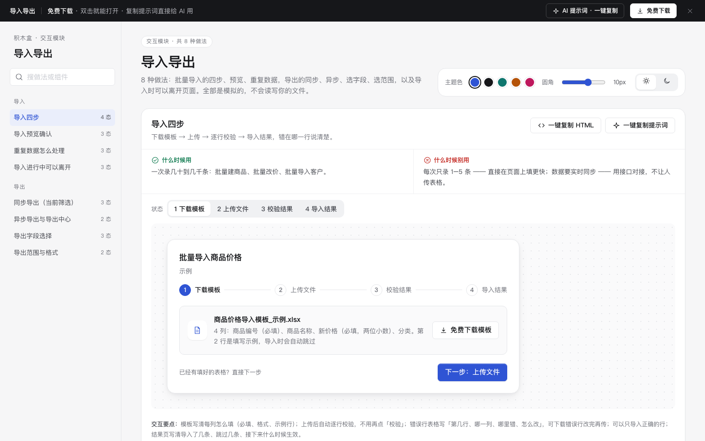

# 导入导出 · 交互模块

免费下载 · 双击就能打开 · 复制提示词直接给 AI 用。

> 积木盒 · 老岳AI编辑部 · 原型组　|　交互模块（组件 → **模块** → 页面模板）　|　单文件 HTML，离线可用　|　2026-11-10

这一页收了 8 种能点的导入导出做法：导入四步、导入预览、重复数据处理、导入中可离开，以及同步导出、异步导出与导出中心、选字段、选范围。全部是模拟的，不会读写你的文件。

---

## 一、用处

| 项 | 说明 |
|---|---|
| 解决什么 | 批量导入最容易出问题的是「错了怎么办」：哪一行错、能不能只导对的、重复的会不会被悄悄覆盖。导出最容易出问题的是「导的是哪些」和「数据多了卡住」。这里每种做法都把这些摆清楚了 |
| 适合谁 | 画后台批量改价、批量建档、导出报表、对账明细这类页面的产品经理 |
| 和页面模板的关系 | 页面模板（如「列表 + 详情抽屉」）右上角的「导出」「导入」按钮，点开后的流程从这里挑 |

## 二、做法清单

| # | 做法 | 状态 | 什么时候用 | 什么时候别用 |
|---|---|---|---|---|
| 1 | 导入四步 | 下载模板 / 上传文件 / 校验结果 / 导入结果 | 一次录几十到几千条 | 每次只录 1–5 条 |
| 2 | 导入预览确认 | 预览前 10 行 / 表头对不上 / 确认导入中 | 第一次导入、用户自己的表格 | 每天导同样格式的老用户 |
| 3 | 重复数据怎么处理 | 选择方式 / 选跳过的结果 / 选覆盖的结果 | 按编号、手机号导入，系统里可能已有 | 数据一定是新的 |
| 4 | 导入进行中可以离开 | 导入中 / 离开后（任务浮层）/ 完成通知 | 导入要 30 秒以上 | 几秒就完成的导入 |
| 5 | 同步导出（当前筛选） | 默认 / 导出中 / 完成 | 几千条以内、几秒能生成 | 可能上万条 |
| 6 | 异步导出与导出中心 | 转后台 / 导出中心 | 上万条、要跑很久 | 几百条的小导出 |
| 7 | 导出字段选择 | 默认（上次的选择）/ 全选 / 一个都没选 | 字段 20 个以上、不同人要的列不同 | 字段不到 10 个 |
| 8 | 导出范围与格式 | 有勾选 / 没勾选 | 列表有勾选、分页、筛选 | 列表很简单、没有勾选 |

## 三、用法

1. 下载文件夹，双击 `index.html`。
2. 左侧目录点到想要的做法，点「状态」切换；演示区能真实走流程（下一步、只导入正确的行、选对应字段、跳过/覆盖、导出、重试）。
3. 右上角换主题色、圆角、明暗，所有演示实时跟着变。
4. **一键复制 HTML**：复制当前状态的 HTML，自带所需 CSS 变量和样式，粘进任意 HTML 原型就能显示（交互逻辑用提示词让 AI 补）。
5. **一键复制提示词**：每种做法一条，交给 AI 就能做出带全部状态的同款。

### 页面上的 AI 提示词

页面顶部「AI 提示词 · 一键复制」里有 3 条，高亮的变量点一下就能就地填写，复制出来就是填好的完整提示词：

| # | 提示词 | 什么时候用 |
|---|---|---|
| 1 | 从零生成整套「导入导出」交互模块 | 想要一份自己的导入导出规范 + 演示 |
| 2 | 把导入导出改成我的业务（变量：做法、业务名称、角色、字段列表、行数上限、导入后的流程） | 已经下载，换成自己的数据 |
| 3 | 在此基础上加一种做法 / 状态（变量：要加的做法、状态清单） | 模块里没有你要的做法 |

## 四、交互说明

| 做法 | 元素 | 交互 | 反馈 |
|---|---|---|---|
| 导入四步 | 步骤条 | 下一步 / 上一步 | 已完成打勾、当前高亮 |
| 导入四步 | 上传区域 | 选好文件 | 自动逐行检查，不用再点「校验」；转圈后进入校验结果 |
| 导入四步 | 校验结果 | 下载错误行 / 改好后重新上传 / 只导入正确的 N 行 | 错误表写「第几行、哪一列、哪里错、怎么改」；顺带写系统已自动处理了什么（去空格、全角转半角） |
| 导入预览 | 表头对应 | 下拉选择「文件里的列」对应哪个系统字段 | 系统先自动猜；没对应上的行标黄；缺必填字段时点确认会说缺哪一列 |
| 重复数据 | 跳过 / 覆盖 | 单选，默认跳过 | 选覆盖时展示一条「旧值 → 新值」；按钮文案跟着变；覆盖前再确认一次 |
| 导入中可离开 | 去做别的 | 点击 | 右下角任务浮层显示进度；完成后变成通知，写清成功 / 失败条数，带「查看结果」 |
| 同步导出 | 导出按钮 | 点击 | 按钮写清「导出当前筛选的 N 条」；导出中转圈、宽度不变；完成提示文件名 |
| 异步导出 | 转后台导出 | 超过 5000 条（示例阈值） | 先说明要多久、完成后怎么通知；进入导出中心 |
| 导出中心 | 任务列表 | 下载 / 重试 / 重新导出 | 处理中显示进度；可下载写过期日期（不做倒计时）；失败写原因 |
| 导出字段 | 勾选 | 勾 / 全选 / 清空 | 实时显示已选个数和导出列顺序；一个都没选时点导出提示「至少选 1 个字段」；记住上次选择，可恢复默认 |
| 导出范围 | 范围 / 格式 | 单选 | 每个范围写条数；没勾选时「已勾选」置灰并说明；按钮文案跟着变 |
| 全页 | 主题色 / 圆角 / 明暗 | 切换 | 所有演示实时变化，记在本机 |

## 五、自检（按《交互设计规范》）

- [x] 每种做法：进行中、出错、完成等状态齐全，可切换
- [x] 每种做法写清「什么时候用 / 什么时候别用」
- [x] 错误写清第几行、哪一列、怎么改；能自动处理的交给系统
- [x] 不把按钮置灰让人猜原因；过期时间写日期，不做倒计时
- [x] 可点元素 ≥ 32px；焦点框清晰；数字等宽；文字对比度 ≥ 4.5:1（浅色、深色都检查）
- [x] 页面上有 3 条 AI 提示词，变量可就地填写，复制有成功反馈
- [x] 无 JS 报错（8 种做法 23 个状态 + 复制 HTML / 提示词 + 明暗切换 + 四步导入、表头对应、覆盖确认、导出、重试、字段、范围、离开页面脚本走查）
- [x] 示例数据标「示例」，无真实公司名

---

本模块由老岳AI编辑部·原型组制作，免费下载、修改、用于工作项目。
