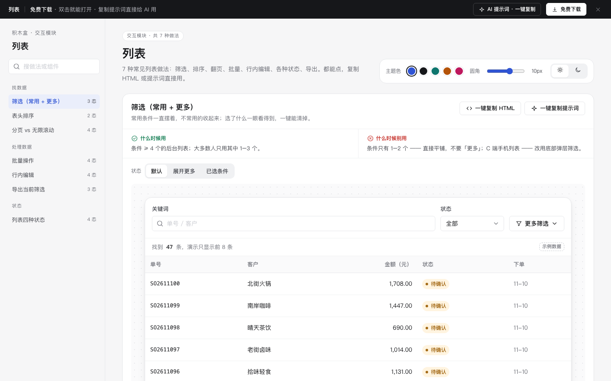

# 列表 · 交互模块

免费下载 · 双击就能打开 · 复制提示词直接给 AI 用。

> 积木盒 · 老岳AI编辑部 · 原型组　|　PC　|　单文件 HTML，离线可用　|　2026-11-10

一页里放了 7 种列表做法，每种都能点、能切状态：筛选、排序、翻页、批量、行内编辑、四种状态、导出。

---

## 一、用处

| 项 | 说明 |
|---|---|
| 适合什么 | 做任何后台列表页之前，先来这里挑做法；评审时点给研发、测试看「这里要这样」 |
| 解决什么 | 列表页最容易漏的：筛选条件怎么收、勾选跨页怎么算、行内改失败了怎么办、导出大量数据怎么等 |
| 和页面模板的关系 | 页面模板（如「列表 + 详情抽屉」）是整页；这里是零件，一种做法一张卡 |

## 二、做法清单

| # | 做法 | 状态 | 什么时候用 | 什么时候别用 |
|---|---|---|---|---|
| 1 | 筛选（常用 + 更多 + 已选标签） | 默认 / 展开更多 / 已选条件 | 条件 ≥4 个、常用 1–3 个 | 条件只有 1–2 个；手机列表 |
| 2 | 表头排序 | 默认 / 按金额降序 | 数字、时间、金额列 | 文字列；多级排序 |
| 3 | 分页 vs 无限滚动 | 分页 / 无限滚动 / 加载失败 / 到底了 | 分页：要回头找、要总数；无限滚动：随手刷 | 页底有重要内容；要批量勾选 |
| 4 | 批量操作 | 未勾选 / 勾满本页 / 已选全部结果 / 含不可操作 | 经常一次处理一批 | 低频单条操作；不可撤销的一键批量删除 |
| 5 | 行内编辑 | 默认 / 编辑中 / 保存中 / 保存失败 | 改一两个简单字段 | 有连锁影响、要审批、长文本 |
| 6 | 列表四种状态 | 加载骨架 / 空态 / 无结果 / 出错 | 每个列表都要做全 | 用一个「暂无数据」打发所有情况 |
| 7 | 导出当前筛选 | 少量直接下载 / 大量后台导出 / 导出完成 | 拿去 Excel 对账、汇报 | 导出范围和页面不一致；长时间无进度 |

## 三、用法

1. 下载整个文件夹，双击 `index.html`，不用联网。
2. 左侧目录点到某种做法 → 切「状态」看效果 → 直接在演示里点、输、勾。
3. 拿走：
   - **一键复制 HTML**：复制当前状态的结构，自带需要的 CSS 变量和样式，粘进任何 HTML 原型就能显示（交互逻辑用提示词让 AI 补上）。
   - **一键复制提示词**：复制这一种做法的完整要求，粘到 AI 对话里让它生成或改造。
4. 换风格：右上角切主题色、圆角、明暗，所有演示实时变；也可以直接改文件顶部 `:root` 里的变量。

## 四、页面上的 AI 提示词

页面顶部「AI 提示词 · 一键复制」打开右侧抽屉，有 3 条，高亮的 `{{变量}}` 点一下就能填，复制时自动替换：

| # | 提示词 | 什么时候用 |
|---|---|---|
| 1 | 从零生成整套「列表」交互模块 | 想要一份列表交互规范 + 可点演示 |
| 2 | 把列表改成我的业务（`{{业务名称}}` `{{角色}}` `{{字段列表}}` `{{状态枚举}}` `{{批量动作}}`） | 下载后换成自己的字段 |
| 3 | 在此基础上加一种做法 / 状态（`{{要加的做法}}` `{{状态清单}}`） | 模块里没有你要的做法 |

## 五、交互说明

| 做法 | 元素 | 交互 | 反馈 |
|---|---|---|---|
| 筛选 | 关键词 | 输入即搜（停 0.2 秒），不用点「查询」 | 「找到 N 条」实时更新 |
| 筛选 | 更多筛选 | 点击展开 / 收起 | 收起时按钮上显示已选个数 |
| 筛选 | 已选标签 | 点 × 删一个；「清除全部」 | 列表和条数立即更新 |
| 排序 | 表头 | 点击：降序 → 升序 → 取消 | 箭头方向变化 + Toast 说明当前排序 |
| 分页 | 页码 / 上下页 | 点击翻页 | 当前页高亮，首末页禁用上下页 |
| 无限滚动 | 列表底部 | 离底 80px 自动加载 | 「加载中…」→ 新数据；失败显示「点击重试」；全部加载完显示「没有更多了」 |
| 批量 | 批量按钮 | 常驻，未勾选置灰 | 「勾选后可批量处理」→「已选 N 条」 |
| 批量 | 表头全选 | 只选本页 | 出现「选择全部 47 条」 |
| 批量 | 批量确认 | 弹确认框 | 写明处理几条、跳过几条及原因；完成后可撤销 |
| 行内编辑 | 单元格 | 悬停出现虚线框；点击变输入框并全选 | Enter / 失焦保存，Esc 取消；保存中转圈；成功闪绿；失败恢复原值并说明原因；非法值就地提示 |
| 状态 | 空 / 无结果 / 出错 | 各自给出路 | 新建、导入 / 清除筛选 / 重新加载（先回骨架） |
| 导出 | 导出按钮 | 写明「导出当前筛选（N 条）」 | ≤1000 条直接下载；更多转后台，显示进度，完成给「下载」 |

## 六、自检

- [x] 7 种做法、24 个状态，逐个切换无 JS 报错（`_kit/gtest.sh` 输出 OK）
- [x] 脚本走查：筛选加删标签、排序、跨页全选 + 批量确认、行内编辑保存、加载失败重试、后台导出完成
- [x] 每种做法有「什么时候用 / 别用」、交互要点、复制 HTML、复制提示词
- [x] 页面顶部「免费下载 · 双击就能打开 · 复制提示词直接给 AI 用」，AI 提示词 3 条
- [x] 弹窗 Esc / 遮罩关闭、焦点锁定；文字对比度 ≥4.5:1；示例数据标「示例」，不出现真实品牌

---

本模块由老岳AI编辑部·原型组制作，可免费下载、修改、用于工作项目。
