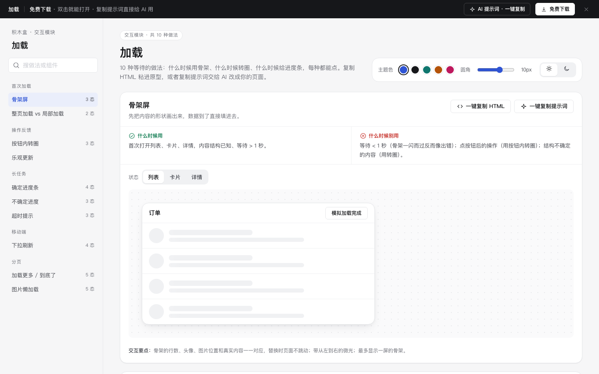

# 加载 · 交互模块

免费下载 · 双击就能打开 · 复制提示词直接给 AI 用。

> 积木盒 · 老岳AI编辑部 · 原型组　|　交互模块（组件 → **模块** → 页面模板）　|　单文件 HTML，离线可用　|　2026-11-10

10 种等待的做法：什么时候用骨架、什么时候转圈、什么时候给进度条，每种都能点。挑一种，复制 HTML 粘进你的原型；或者复制提示词，让 AI 改成你的页面。

---

## 一、用处

| 项 | 说明 |
|---|---|
| 解决什么 | 「加载中」是原型里最常画成一个转圈了事的地方。这里把 10 种等待场景拆开，每种写清用哪种方式、等多久换说法、失败怎么办 |
| 一句话选法 | 内容结构已知、等 > 1 秒 → **骨架**；点按钮后的短操作 → **按钮内转圈**；能算百分比 → **进度条**；不知道多久的长任务 → **不确定进度 + 允许离开**；< 1 秒 → **什么都不放** |
| 和页面模板的关系 | 页面模板里的「加载」状态从这里挑；拼新页面时直接复制 |

## 二、做法清单

| # | 做法 | 状态 | 什么时候用 | 什么时候别用 |
|---|---|---|---|---|
| 1 | 骨架屏 | 列表 / 卡片 / 详情 | 首次打开、结构已知、等 > 1 秒 | 等 < 1 秒；按钮操作；结构不确定 |
| 2 | 按钮内转圈 | 默认 / 保存中 / 试一下 | 0.3–3 秒的保存、提交 | 超过 3 秒的长任务 |
| 3 | 整页 vs 局部加载 | 整页 / 局部 | 整页：首次进入；局部：切分类、翻页 | 切个筛选就整页重载 |
| 4 | 确定进度条 | 进行中 / 失败 / 完成 / 试一下 | 能算百分比、> 3 秒（上传、导出） | 算不出总量 |
| 5 | 不确定进度 | 短等待 / 长任务 / 已转到后台 | 查询校验；生成报表等长任务 | 能算百分比时；长任务卡住不让走 |
| 6 | 乐观更新 | 试一下 | 点赞、收藏、改名等高成功率小操作 | 付款、下单、删除 |
| 7 | 下拉刷新 | 拖动试试 / 下拉中 / 松手刷新 / 刷新中 | 手机端按时间排的列表 | PC 端；不会变的内容 |
| 8 | 加载更多 / 到底了 | 按钮式 / 自动 / 加载中 / 到底了 / 失败 | 手机列表、信息流、评论 | 要跳页、要知道总数的后台表格 |
| 9 | 超时提示 | 试一下（已加速）/ 超过 10 秒 / 已取消 | 偶尔很慢的查询 | 本来就很久的任务 |
| 10 | 图片懒加载 | 占位 / 加载中 / 已加载 / 失败 / 试一下 | 大量商品图、相册 | 首屏主图 |

## 三、用法

1. 下载文件夹，双击 `index.html`。
2. 左侧目录点到想要的做法，切状态看效果；「试一下」状态可以真实操作。
3. 右上角换主题色、圆角、明暗，所有演示实时跟着变。
4. **一键复制 HTML**：复制当前状态的 HTML，自带所需的 CSS 变量和样式（含骨架微光、转圈动画），粘进原型就能显示。
5. **一键复制提示词**：每种做法都有一条，交给 AI 就能做出带全部状态的同款。

### 页面上的 AI 提示词

| # | 提示词 | 什么时候用 |
|---|---|---|
| 1 | 从零生成整套「加载」交互模块 | 想要一份自己的加载态规范 + 演示 |
| 2 | 把加载态改成我的业务（变量：做法、页面名称、字段列表、等待时长、出路） | 已经下载，换成自己的页面 |
| 3 | 在此基础上加一种加载做法 / 状态（变量：要加的做法、状态清单） | 模块里没有你要的场景 |

## 四、交互说明

| 做法 | 元素 | 交互 | 反馈 |
|---|---|---|---|
| 骨架屏 | 模拟加载完成 | 点击 | 骨架换成真实内容，位置一一对应、不跳动 |
| 按钮内转圈 | 保存 | 点击 | 按钮宽度不变、转圈 +「保存中…」、禁用；1.2 秒后恢复并 Toast |
| 局部加载 | 左侧分类 | 点击 | 只有右侧内容盖半透明遮罩 + 转圈，导航可继续点 |
| 确定进度条 | 开始 / 取消 / 重试 | 点击 | 实时百分比和剩余时间；取消先二次确认；失败从断点重试；完成变绿 |
| 不确定进度 | 转到后台 | 点击 | 页面恢复可用，底部留任务条，可随时点开 |
| 乐观更新 | 点赞 / 改名 | 点击 / 失焦 | 立即变化；勾「下次失败」时 0.8 秒后回滚并提示「已恢复原样」 |
| 下拉刷新 | 列表 | 用鼠标或手指往下拖 | 超过 64px 箭头翻转「松手刷新」；松手转圈；新内容高亮 + Toast |
| 加载更多 | 加载更多 / 滚动 | 点击或滚到底 | 加载中转圈；满 12 条显示「到底了 · 共 12 条」；失败点击重试，已有内容不清空 |
| 超时提示 | 取消 / 继续等待 | 超过 10 秒（演示加速为 2 秒）后出现 | 取消后条件保留，给「重新查询」 |
| 图片懒加载 | 模拟滚到眼前 / 点击重试 | 点击 | 占位 → 微光 → 淡入；失败的那张点一下单独重试 |

## 五、自检（按《交互设计规范》）

- [x] 每种做法写清用骨架 / 转圈 / 进度条中的哪种、为什么
- [x] 加载中、完成、失败、到底了等状态齐全，可切换、可真实操作
- [x] 动效只动 transform / opacity，尊重系统「减少动态效果」
- [x] 可点元素 ≥ 32px（手机 ≥ 44px）；文字对比度 ≥ 4.5:1（浅色、深色都检查）
- [x] 页面上有 3 条 AI 提示词，变量可就地填写，复制有成功反馈
- [x] 无 JS 报错（10 种做法 33 个状态 + 复制 HTML / 提示词 + 明暗切换 + 关键交互脚本走查）
- [x] 示例数据标「示例」，无真实公司名

---

本模块由老岳AI编辑部·原型组制作，免费下载、修改、用于工作项目。
