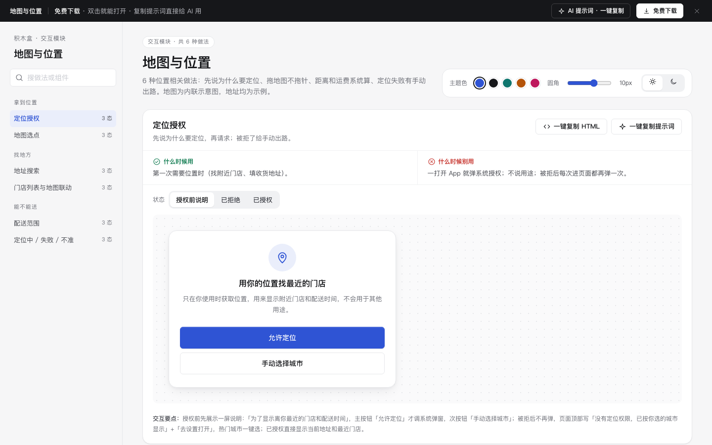

# 地图与位置 · 交互模块

免费下载 · 双击就能打开 · 复制提示词直接给 AI 用。

> 积木盒 · 老岳AI编辑部 · 原型组　|　交互模块（组件 → **模块** → 页面模板）　|　单文件 HTML，离线可用　|　2026-11-10

这是一页能点的「地图与位置」做法合集：6 种做法 18 个状态，每种都能切状态、能真实操作。6 种位置相关做法：先说为什么要定位、拖地图不拖针、距离和运费系统算、定位失败有手动出路。地图为内联示意图，地址均为示例。 挑一种，复制 HTML 粘进你的原型；或者复制提示词，让 AI 改成你的业务。

---

## 一、用处

| 项 | 说明 |
|---|---|
| 解决什么 | 位置相关最常见的坑：一打开就弹定位授权、被拒后反复弹、让手指去拖针、松手不显示地址、联想不写距离、列表和地图选中不同步、只写「超出范围」不说超多少、定位失败一直转圈 |
| 适合谁 | 要画外卖、生鲜到家、到店自提、上门服务、找门店的产品经理 |
| 和页面模板的关系 | 页面模板是整页；模块是其中一块的多种做法（c-checkout 的收货地址、c-booking 的门店选择从这里挑） |

## 二、做法清单

| # | 做法 | 状态 | 什么时候用 | 什么时候别用 |
|---|---|---|---|---|
| 1 | 定位授权 | 授权前说明 / 已拒绝 / 已授权 | 第一次需要位置时（找附近门店、填收货地址）。 | 一打开 App 就弹系统授权；不说用途；被拒后每次进页面都再弹一次。 |
| 2 | 地图选点 | 拖动中 / 已选定 / 不在服务范围 | 收货地址精确到楼栋、上门服务地点、打车上车点。 | 让人去拖那根针（手指会挡住针尖）；松手后不显示解析出的地址；超出范围到提交才报错。 |
| 3 | 地址搜索 | 历史地址 / 输入中联想 / 没有结果 | 填收货地址、搜目的地、搜门店。 | 联想结果不写距离分不清是哪个；没有结果只写「无结果」；每次都要重新搜常用地址。 |
| 4 | 门店列表与地图联动 | 列表 / 选中门店 / 附近没有门店 | 找门店、自提点、网点、充电桩。 | 只有地图没有列表（看不出哪个最近）；只有列表没有地图（看不出在哪个方向）；两边选中状态不同步。 |
| 5 | 配送范围 | 在范围内 / 超出范围 / 部分时段可送 | 外卖、生鲜到家、上门服务，按距离收费或限制范围。 | 只写「超出配送范围」不说超了多少；运费只给一个数不说怎么来的；分时段配送却不告诉用户哪些时段能送。 |
| 6 | 定位中 / 失败 / 不准 | 定位中 / 定位失败 / 定位不准 | 所有依赖定位的页面。 | 一直转圈没有超时；失败只写「定位失败」；精度 500 米还直接当作准确地址下单。 |

## 三、用法

1. 下载文件夹，双击 `index.html`。
2. 左侧目录点到想要的做法，点「状态」切换，演示区里可以真实操作。
3. 右上角换主题色、圆角、明暗，所有演示实时跟着变。
4. **一键复制 HTML**：复制当前状态的 HTML，自带所需 CSS 变量和样式，粘进任意 HTML 原型就能显示（交互逻辑用提示词让 AI 补）。
5. **一键复制提示词**：每种做法一条，交给 AI 就能做出带全部状态的同款。

### 页面上的 AI 提示词

页面顶部「AI 提示词 · 一键复制」里有 3 条，高亮变量点一下就能填，复制出来就是填好的完整提示词：

| # | 提示词 | 什么时候用 |
|---|---|---|
| 1 | 从零生成整套「地图与位置」交互模块 | 想要一份自己的地图与位置规范 + 演示 |
| 2 | 把地图与位置改成我的产品（变量：产品名称、用途、门店清单、规则、默认城市） | 已下载，换成自己的数据和规则 |
| 3 | 在此基础上加一种做法 / 状态（变量：要加的做法、状态清单） | 模块里没有你要的做法 |

## 四、交互说明

| 做法 | 元素 → 交互 → 反馈 |
|---|---|
| 定位授权 | 授权前先展示一屏说明：「为了显示离你最近的门店和配送时间」，主按钮「允许定位」才调系统弹窗，次按钮「手动选择城市」；被拒后不再弹，页面顶部写「没有定位权限，已按你选的城市显示」+「去设置打开」，热门城市一键选；已授权直接显示当前地址和最近门店。 |
| 地图选点 | 针固定在地图中心，拖动地图时针抬起、底部显示「正在获取地址…」，松手后写解析出的地点名和详细地址；右下角「回到我的位置」；超出 3 km 配送范围时底部变黄写「超出配送范围 0.6 km」并给「改到最近可送地址」，确认按钮置灰；键盘可用方向键平移。 |
| 地址搜索 | 聚焦即显示最近用过的 3 个地址（可删除单条）；输入后停 0.2 秒出联想，命中字主色加粗，每条写详细地址和距离，按距离排序；↑↓ 选择、回车确认；没有结果时建议「换个关键词，比如小区名或路名」并给「在地图上选点」。 |
| 门店列表与地图联动 | 左列表右地图（手机上上下排），列表按距离排序、写营业时间和距离，编号与地图标记一致；点列表项 → 对应标记放大变主色；点标记 → 列表滚到并高亮该项；选中后底部出现「到这家自提」；3 km 内没有门店时写清，并给「扩大到 10 km」「改为送货上门」。 |
| 配送范围 | 地图上门店为中心画虚线圈（绿色 = 全天可送 3 km，黄色 = 仅午间可送 5 km）；底部写距离和运费，运费公式「(距离 − 2 km) × ¥2 / km」，2 km 内免运费；超出范围写超了多少 + 两个出路（换地址 / 到店自提）；部分时段写清「只有 11:00–13:00 能送」。 |
| 定位中 / 失败 / 不准 | 定位中：地图中心蓝点脉冲 +「正在定位…」，超过 8 秒自动转失败；失败：写可能原因（室内信号弱 / 定位服务关闭），给「重试」「手动输入地址」；精度大于 200 米：画出误差圈，写「位置可能不准（误差约 500 米）」，请用户在地图上确认或搜索。 |

## 五、自检（按《交互设计规范》）

- [x] 每种做法的状态齐全，可切换，能真实操作
- [x] 每种做法写清「什么时候用 / 什么时候别用」
- [x] 先说用途再请求权限，被拒后不反复弹窗
- [x] 计算交给系统：距离、运费公式、超出多少、最近可送地址都由系统算
- [x] 选择优于输入：历史地址、热门城市、门店列表点选
- [x] 地图为内联 SVG 示意图，不调用任何在线地图，离线可开
- [x] 可点元素 ≥ 32px；焦点框清晰；对比度 ≥ 4.5:1
- [x] 弹窗：Esc / 点遮罩关闭、焦点锁定、关闭后焦点回到触发处
- [x] 页面上有 3 条 AI 提示词，变量可就地填写，复制有成功反馈
- [x] 无 JS 报错（6 种做法 18 个状态自测 OK + 关键交互走查）
- [x] 示例数据标「示例」，无真实公司名和品牌

---

本模块由老岳AI编辑部·原型组制作，免费下载、修改、用于工作项目。
