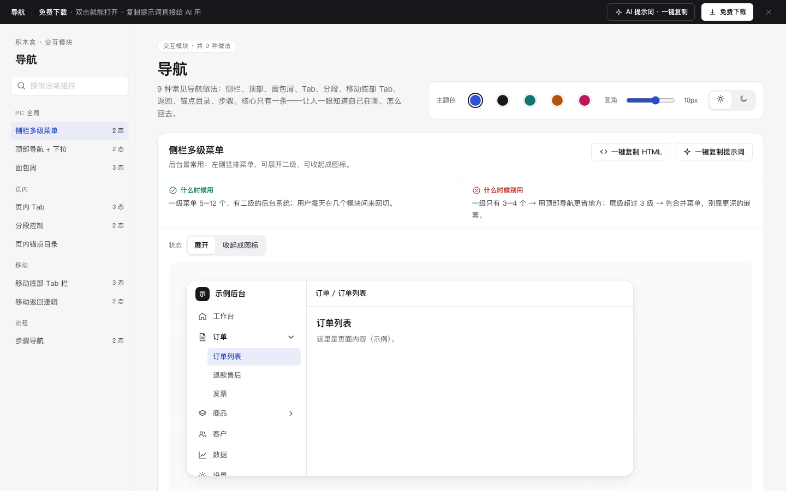

# 导航 · 交互模块

免费下载 · 双击就能打开 · 复制提示词直接给 AI 用。

> 积木盒 · 老岳AI编辑部 · 原型组　|　交互模块（组件 → **模块** → 页面模板）　|　单文件 HTML，离线可用　|　2026-11-10

这页把导航的 9 种做法放在一起：侧栏、顶部、面包屑、Tab、分段、移动底部 Tab、返回、锚点目录、步骤。每种都能点、能切状态。核心只有一条：让人一眼知道自己在哪、怎么回去。

---

## 一、用处

| 项 | 说明 |
|---|---|
| 解决什么 | 画原型时导航常被一笔带过，评审时才发现：二级菜单当前页怎么高亮？面包屑太长怎么办？Tab 放不下怎么办？有未保存内容时点返回会怎样？这里每种做法都给了答案 |
| 适合谁 | 搭新系统框架、新 App 一级结构的产品经理；做信息架构评审的时候 |
| 和页面模板的关系 | 所有 PC 页面模板的侧栏和面包屑、手机模板的底部 Tab 都是这里的做法 |

## 二、做法清单

| # | 做法 | 状态 | 什么时候用 | 什么时候别用 |
|---|---|---|---|---|
| 1 | 侧栏多级菜单 | 展开 / 收起成图标 | 一级 5–12 个、有二级的后台 | 一级只有 3–4 个；层级超过 3 级 |
| 2 | 顶部导航 + 下拉 | 默认 / 下拉展开 | 一级 3–7 个、内容区要宽 | 一级超过 7 个；二级要常驻 |
| 3 | 面包屑 | 层级少 / 层级多（折叠）/ 当前页名很长 | 层级 ≥ 3 | 只有一两层；当主导航用 |
| 4 | 页内 Tab | 普通 / 带计数 / 溢出滚动 | 同一对象的几类内容互相独立 | 超过 7 个；要对照着看 |
| 5 | 分段控制 | 切视图 / 切时间 | 2–5 个互斥选项、选了马上生效 | 选项多或名字长；切的是不同页面 |
| 6 | 移动底部 Tab 栏 | 默认 / 红点 / 数字角标 | App 有 3–5 个同等重要的一级入口 | 超过 5 个；把一次性动作当入口 |
| 7 | 移动返回逻辑 | 没改动 / 有未保存内容 | 所有二级页；编辑页有改动时先确认 | 每次返回都弹确认 |
| 8 | 页内锚点目录 | 默认 | 超过三屏、要从头读到尾 | 不到两屏；各节互不相关 |
| 9 | 步骤导航 | 进行中 / 有一步出错 | 3–6 步、有先后顺序 | 只有 2 步；步骤可随便跳 |

## 三、用法

1. 下载文件夹，双击 `index.html`。
2. 左侧目录点到想要的做法，点「状态」切换看效果，演示区里可以真实操作（展开菜单、切 Tab、点返回、点目录）。
3. 右上角换主题色、圆角、明暗，所有演示实时跟着变。
4. **一键复制 HTML**：复制当前状态的 HTML，自带所需 CSS 变量和样式，粘进任意 HTML 原型就能显示（交互逻辑用提示词让 AI 补上）。
5. **一键复制提示词**：每种做法一条，交给 AI 就能做出带全部状态的同款。

### 页面上的 AI 提示词

页面顶部「AI 提示词 · 一键复制」里有 3 条，高亮的变量点一下就能就地填写，复制出来就是填好的完整提示词：

| # | 提示词 | 什么时候用 |
|---|---|---|
| 1 | 从零生成整套「导航」交互模块 | 想要一份自己的导航交互规范 + 演示 |
| 2 | 把导航改成我的系统（变量：做法、业务名称、角色、菜单清单、带提醒的入口） | 已经下载，换成自己的菜单结构 |
| 3 | 在此基础上加一种做法 / 状态（变量：要加的做法、状态清单） | 模块里没有你要的做法 |

## 四、交互说明

| 做法 | 元素 | 交互 | 反馈 |
|---|---|---|---|
| 侧栏 | 父级菜单 | 点击展开 / 收起子菜单，不跳页 | 箭头旋转；子菜单当前项主色、父级加粗 |
| 侧栏 | 收起菜单 | 点击 | 只剩图标，悬停显示名字；收起时点父级会先展开侧栏 |
| 顶部导航 | 带下拉的一级 | 点击展开 | 焦点进入第一项；↑ ↓ 移动；Esc / 点外面关闭，焦点回到按钮 |
| 面包屑 | 上层链接 / 「…」 | 点击跳回 / 展开完整路径 | 当前页加粗不可点；长名字省略号，悬停看全名 |
| 页内 Tab | Tab | 点击或键盘 ← → | 主色下划线；溢出时两侧箭头可滚动，到头置灰 |
| 分段控制 | 选项 | 点击 | 白底浮起，结果文字立即更新 |
| 底部 Tab | Tab | 点击切换；点当前项 | 当前项主色加粗；点当前项提示回到顶部；角标超过 99 显示「99+」 |
| 返回逻辑 | 左上角返回 | 点击 | 没改动直接回列表；有改动先弹「放弃编辑 / 继续编辑」 |
| 锚点目录 | 目录项 / 滚动 | 点击或滚动内容 | 平滑滚到对应小节；目录高亮跟随 |
| 步骤导航 | 步骤 / 上一步 / 下一步 | 已完成步骤可点回；未到的不可点 | 出错步骤变红并写原因；有错时点下一步会跳回出错步骤 |

## 五、自检（按《交互设计规范》）

- [x] 每种做法的适用状态齐全，可切换
- [x] 每种做法写清「什么时候用 / 什么时候别用」
- [x] 当前位置一眼可见（高亮、加粗、下划线、aria-current）
- [x] 键盘可操作（下拉 ↑ ↓ Esc、Tab ← →），焦点框清晰
- [x] PC 可点元素 ≥ 32px，移动 ≥ 44px；文字对比度 ≥ 4.5:1（浅色、深色）
- [x] 页面上有 3 条 AI 提示词，变量可就地填写，复制有成功反馈
- [x] 无 JS 报错（9 种做法 20 个状态 + 复制 HTML / 提示词 + 明暗切换 + 关键交互脚本走查）
- [x] 示例数据标「示例」，无真实公司名

---

本模块由老岳AI编辑部·原型组制作，免费下载、修改、用于工作项目。

## 本次清理提示词

### 从零构建导航

请制作「导航」的单文件离线原型，服务于{{业务名称}}的{{使用角色}}。逐项实现下列做法与状态，不只画静态截图：
侧栏多级菜单（展开、收起成图标）；点父级只展开 / 收起子菜单，不跳页；当前页高亮主色，所属父级加粗并保持展开；收起后只剩图标，悬停显示名字（title），收起状态记在本机；底部「收起」按钮固定位置。
顶部导航 + 下拉（默认、下拉展开）；当前一级下方主色短横线；点有下拉的一级展开，每项带一句说明；点外面或按 Esc 关闭并把焦点还给按钮；键盘 ↑ ↓ 在下拉里移动；下拉打开时按钮保持按下态。
面包屑（层级少、层级多（折叠）、当前页名很长）；上层都是可点链接，当前页加粗不可点；超过 4 层时中间折叠成「…」，点开展示完整路径；当前页名过长用省略号，悬停显示全名；分隔符用细箭头图标。
页内 Tab（普通、带计数、溢出滚动）；当前 Tab 文字加深 + 底部主色线；计数用浅色徽标，0 也显示；溢出时两侧出现箭头，到头置灰，当前 Tab 自动滚进可视区；键盘 ← → 切换（role=tablist）。
分段控制（切视图、切时间）；当前项白底浮起，其他项灰字；切换即生效，不刷新页面、不丢筛选；记住上次选择；键盘 Tab 可聚焦、空格切换。
移动底部 Tab 栏（默认、红点、数字角标）；图标 + 文字，当前项主色加粗；每项触控 ≥ 44px；红点表示「有新内容」不说数量，数字角标超过 99 显示「99+」；点当前项回到顶部；切换时保留各 Tab 的浏览位置。
移动返回逻辑（没改动、有未保存内容）；左上角返回按钮触控 ≥ 44px；没改动直接回上一页；有改动时底部弹层二选一「放弃编辑 / 继续编辑」，危险项红字；系统返回手势同样触发。
页内锚点目录（默认）；目录固定在右侧；滚动时高亮当前小节（以内容区顶部 40px 为准）；点目录平滑滚到对应小节并更新地址里的锚点；小节标题用 h 级标题，方便屏幕阅读器跳转。
步骤导航（进行中、有一步出错）；已完成：主色描边 + 勾，可点回去改；当前：主色实心；未到：灰色不可点；某步校验没过时该步变红并写原因；返回已完成步骤修改后，后面的步骤内容保留。
业务字段：菜单名称、当前页面、父级路径、步骤编号、未保存内容。按{{校验规则}}验证必填、格式与权限；保留搜索目录、主题色、圆角、深浅色、下载和提示词面板，提供真实操作及取消恢复。使用逐行不同的业务演示数据。

### 替换导航业务数据

将附件「导航」接入{{业务场景}}，字段映射由{{字段映射}}就地填写。必须保留这些业务做法及状态：
侧栏多级菜单（展开、收起成图标）；点父级只展开 / 收起子菜单，不跳页；当前页高亮主色，所属父级加粗并保持展开；收起后只剩图标，悬停显示名字（title），收起状态记在本机；底部「收起」按钮固定位置。
顶部导航 + 下拉（默认、下拉展开）；当前一级下方主色短横线；点有下拉的一级展开，每项带一句说明；点外面或按 Esc 关闭并把焦点还给按钮；键盘 ↑ ↓ 在下拉里移动；下拉打开时按钮保持按下态。
面包屑（层级少、层级多（折叠）、当前页名很长）；上层都是可点链接，当前页加粗不可点；超过 4 层时中间折叠成「…」，点开展示完整路径；当前页名过长用省略号，悬停显示全名；分隔符用细箭头图标。
页内 Tab（普通、带计数、溢出滚动）；当前 Tab 文字加深 + 底部主色线；计数用浅色徽标，0 也显示；溢出时两侧出现箭头，到头置灰，当前 Tab 自动滚进可视区；键盘 ← → 切换（role=tablist）。
分段控制（切视图、切时间）；当前项白底浮起，其他项灰字；切换即生效，不刷新页面、不丢筛选；记住上次选择；键盘 Tab 可聚焦、空格切换。
移动底部 Tab 栏（默认、红点、数字角标）；图标 + 文字，当前项主色加粗；每项触控 ≥ 44px；红点表示「有新内容」不说数量，数字角标超过 99 显示「99+」；点当前项回到顶部；切换时保留各 Tab 的浏览位置。
移动返回逻辑（没改动、有未保存内容）；左上角返回按钮触控 ≥ 44px；没改动直接回上一页；有改动时底部弹层二选一「放弃编辑 / 继续编辑」，危险项红字；系统返回手势同样触发。
页内锚点目录（默认）；目录固定在右侧；滚动时高亮当前小节（以内容区顶部 40px 为准）；点目录平滑滚到对应小节并更新地址里的锚点；小节标题用 h 级标题，方便屏幕阅读器跳转。
步骤导航（进行中、有一步出错）；已完成：主色描边 + 勾，可点回去改；当前：主色实心；未到：灰色不可点；某步校验没过时该步变红并写原因；返回已完成步骤修改后，后面的步骤内容保留。
逐一核对菜单名称、当前页面、父级路径、步骤编号、未保存内容的来源、默认值与提交范围。将演示值替换为{{业务数据}}，输入变更后重新校验；说明确认前后的数据变化与失败保留内容。交付可离线运行的完整HTML与字段说明。

### 核对导航交互边界

请对「导航」开展交互边界修订，重点场景为{{边界场景}}，验收条件为{{验收条件}}。以下是本模块必须逐项走通的做法和状态清单：
侧栏多级菜单（展开、收起成图标）；点父级只展开 / 收起子菜单，不跳页；当前页高亮主色，所属父级加粗并保持展开；收起后只剩图标，悬停显示名字（title），收起状态记在本机；底部「收起」按钮固定位置。
顶部导航 + 下拉（默认、下拉展开）；当前一级下方主色短横线；点有下拉的一级展开，每项带一句说明；点外面或按 Esc 关闭并把焦点还给按钮；键盘 ↑ ↓ 在下拉里移动；下拉打开时按钮保持按下态。
面包屑（层级少、层级多（折叠）、当前页名很长）；上层都是可点链接，当前页加粗不可点；超过 4 层时中间折叠成「…」，点开展示完整路径；当前页名过长用省略号，悬停显示全名；分隔符用细箭头图标。
页内 Tab（普通、带计数、溢出滚动）；当前 Tab 文字加深 + 底部主色线；计数用浅色徽标，0 也显示；溢出时两侧出现箭头，到头置灰，当前 Tab 自动滚进可视区；键盘 ← → 切换（role=tablist）。
分段控制（切视图、切时间）；当前项白底浮起，其他项灰字；切换即生效，不刷新页面、不丢筛选；记住上次选择；键盘 Tab 可聚焦、空格切换。
移动底部 Tab 栏（默认、红点、数字角标）；图标 + 文字，当前项主色加粗；每项触控 ≥ 44px；红点表示「有新内容」不说数量，数字角标超过 99 显示「99+」；点当前项回到顶部；切换时保留各 Tab 的浏览位置。
移动返回逻辑（没改动、有未保存内容）；左上角返回按钮触控 ≥ 44px；没改动直接回上一页；有改动时底部弹层二选一「放弃编辑 / 继续编辑」，危险项红字；系统返回手势同样触发。
页内锚点目录（默认）；目录固定在右侧；滚动时高亮当前小节（以内容区顶部 40px 为准）；点目录平滑滚到对应小节并更新地址里的锚点；小节标题用 h 级标题，方便屏幕阅读器跳转。
步骤导航（进行中、有一步出错）；已完成：主色描边 + 勾，可点回去改；当前：主色实心；未到：灰色不可点；某步校验没过时该步变红并写原因；返回已完成步骤修改后，后面的步骤内容保留。
围绕业务字段菜单名称、当前页面、父级路径、步骤编号、未保存内容检查无输入、非法值、取消、重复操作及失败恢复；每条路径写出触发、反馈和恢复位置。保持500px宽度、浅深色对比度及至少24px触控目标，返回完整代码和验收记录。

## 第2轮完整实测清单修订（fix14b）

目录、订单菜单、首页Tab和适用范围使用修正后的主题前景；红色数字角标随危险底色使用深色字；面包屑省略按钮至少32px（窄屏44px），滑块44px。

本轮保留全部业务内容与提示词。已通过脚本语法与静态增量检查；本轮未运行真实浏览器验收，详见根目录 `codex_交付_fix14b.md`。

状态：已通过浏览器验收（1440/500 宽 0 报错、0 溢出、对比度与触控达标；标准外壳与跨目录比对通过）
