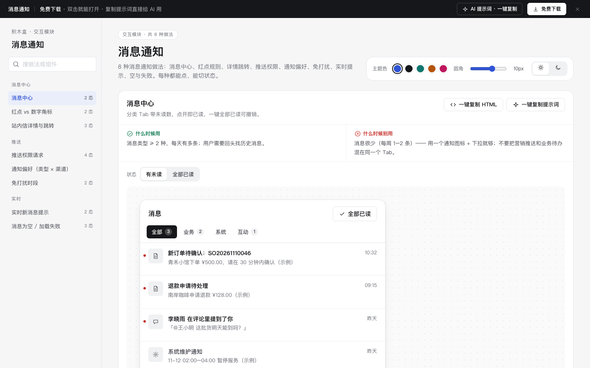

# 消息通知 · 交互模块

免费下载 · 双击就能打开 · 复制提示词直接给 AI 用。

> 积木盒 · 老岳AI编辑部 · 原型组　|　交互模块（组件 → **模块** → 页面模板）　|　单文件 HTML，离线可用　|　2026-11-10

这是一页能点的消息通知做法合集：8 种做法，每种都能切状态、能真实操作。挑一种，复制 HTML 粘进你的原型；或者复制提示词，让 AI 改成你的消息类型。

---

## 一、用处

| 项 | 说明 |
|---|---|
| 解决什么 | 消息通知最容易做成「打扰」：什么都推、什么都挂红色数字、一打开就要权限。这里把消息中心、角标规则、权限请求、偏好、免打扰、实时提示的做法和状态都摆出来了 |
| 适合谁 | 要设计消息中心、App 推送、通知设置的产品经理 |
| 和页面模板的关系 | 页面模板是整页；模块是其中一块的多种做法，拼页面时从这里挑 |

## 二、做法清单

| # | 做法 | 状态 | 什么时候用 | 什么时候别用 |
|---|---|---|---|---|
| 1 | 消息中心 | 有未读 / 全部已读 | 消息类型 ≥ 2 种、每天多条 | 每周 1–2 条，用下拉就够 |
| 2 | 红点 vs 数字角标 | 规则对照 / 试一下 | 数字：要知道几条待处理；红点：只提醒有新东西 | 每个入口都挂数字 |
| 3 | 站内信详情与跳转 | 列表 / 详情 / 跳转目标已失效 | 消息背后有事要处理 | 纯告知类短消息 |
| 4 | 推送权限请求 | 说明页 / 系统弹窗 / 已允许 / 已拒绝 | 首次需要推送时，在用户刚做完相关的事之后 | 一打开 App 就弹系统框 |
| 5 | 通知偏好（类型 × 渠道） | 默认 | 消息类型多、渠道多 | 只有一种消息 |
| 6 | 免打扰时段 | 关闭 / 开启（跨天） | 下班时间会收到推送的产品 | 默认打开免打扰 |
| 7 | 实时新消息提示 | 顶部横幅 / 静默加角标 | 横幅：要马上处理的；角标：不急的 | 每条都弹横幅 |
| 8 | 消息为空 / 加载失败 | 空 / 加载失败 / 部分失败 | 所有消息列表都要有 | 只写「暂无数据」 |

## 三、用法

1. 下载文件夹，双击 `index.html`。
2. 左侧目录点到想要的做法，点「状态」切换，演示区里可以真实操作（「实时新消息提示」里点「模拟来一条新消息」）。
3. 右上角换主题色、圆角、明暗，所有演示实时跟着变。
4. **一键复制 HTML**：复制当前状态的 HTML，自带所需 CSS 变量和样式，粘进任意 HTML 原型就能显示（交互逻辑用提示词让 AI 补）。
5. **一键复制提示词**：每种做法一条，交给 AI 就能做出带全部状态的同款。

### 页面上的 AI 提示词

页面顶部「AI 提示词 · 一键复制」里有 3 条，高亮变量点一下就能填，复制出来就是填好的完整提示词：

| # | 提示词 | 什么时候用 |
|---|---|---|
| 1 | 从零生成整套「消息通知」交互模块 | 想要一份自己的通知规范 + 演示 |
| 2 | 把消息通知改成我的产品（变量：做法、产品名称、角色、消息类型清单、渠道） | 已下载，换成自己的消息类型 |
| 3 | 在此基础上加一种做法 / 状态（变量：要加的做法、状态清单） | 模块里没有你要的做法 |

## 四、交互说明

| 做法 | 元素 | 交互 | 反馈 |
|---|---|---|---|
| 消息中心 | 消息行 | 点击 / Enter | 标为已读（加粗和红点消失），Tab 数字同步减，提示跳到对应业务页 |
| 消息中心 | 标为已读 | 悬停出现，点击 | 只标这一条 |
| 消息中心 | 全部已读 | 点击 | 只作用于当前 Tab；Toast 5 秒内可撤销 |
| 红点 vs 数字 | 加减按钮 | 改未读数 | 0 不显示、1–99 显示数字、≥100 显示 99+ |
| 详情与跳转 | 去处理 | 点击 | 直达业务页；目标已失效时写原因并给替代入口 |
| 推送权限 | 开启通知 / 以后再说 | 点「开启」才弹系统框；「以后再说」不弹 | 允许：说明可按类型关；拒绝：写清去系统设置的 3 步 |
| 通知偏好 | 勾选框 | 勾选即保存 | Toast 写清开了 / 关了哪类哪个渠道；安全类整行锁定并说明原因 |
| 免打扰 | 开关 + 时段 | 打开才展开时段 | 下方一句话复述效果，跨天写「次日」；开始结束相同时提示并还原 |
| 实时提示 | 模拟来一条新消息 | 点击 | 横幅从顶部滑入，5 秒自动收起、悬停不收；连续多条合并为「N 条新消息」；角标同步加；声音开关记在本机 |
| 空 / 失败 | 重试 | 点击 | 先出骨架再出结果；部分失败只重试失败的那一类 |

## 五、自检（按《交互设计规范》）

- [x] 每种做法的状态齐全，可切换，能真实操作
- [x] 每种做法写清「什么时候用 / 什么时候别用」
- [x] 未读不只靠颜色（加粗 + 圆点）；角标带白描边
- [x] 可点元素 ≥ 32px；焦点框清晰；对比度 ≥ 4.5:1
- [x] 推送权限先讲用处再请求，被拒不反复弹
- [x] 页面上有 3 条 AI 提示词，变量可就地填写，复制有成功反馈
- [x] 无 JS 报错（8 种做法 19 个状态自测 OK + 关键交互脚本走查）
- [x] 示例数据标「示例」，无真实公司名

---

本模块由老岳AI编辑部·原型组制作，免费下载、修改、用于工作项目。
