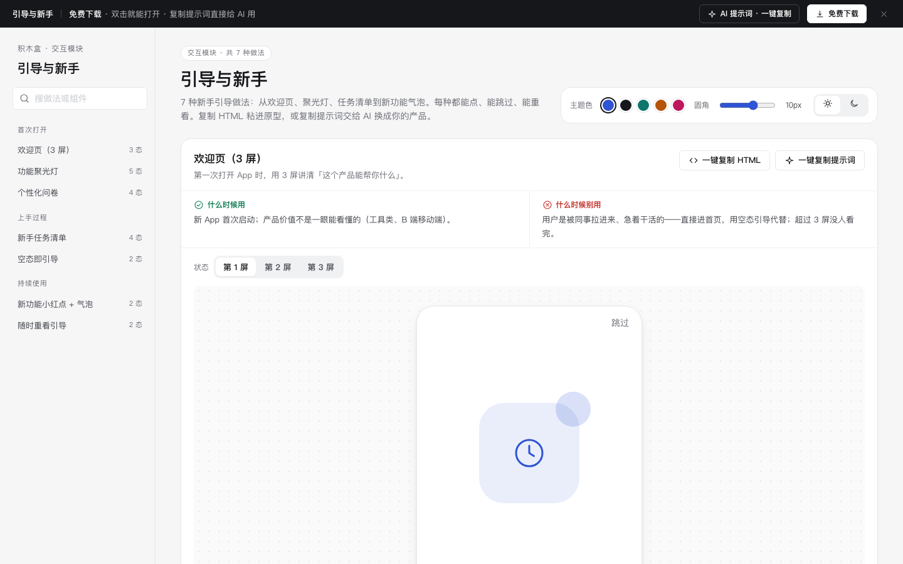

# 引导与新手 · 交互模块

免费下载 · 双击就能打开 · 复制提示词直接给 AI 用。

> 积木盒 · 老岳AI编辑部 · 原型组　|　交互模块（组件 → **模块** → 页面模板）　|　单文件 HTML，离线可用　|　2026-11-10

这一页收了 7 种新手引导的做法，从欢迎页、聚光灯、任务清单到新功能气泡，每种都能点、能跳过、能重看。挑一种，复制 HTML 粘进原型；或者复制提示词，让 AI 换成你产品的内容。

---

## 一、用处

| 项 | 说明 |
|---|---|
| 解决什么 | 引导最容易做成两种坏样子：一种是一上来 8 屏讲功能，没人看；另一种是关了就再也找不回来。这里每种做法都写清了什么时候用、什么时候别用，也都留着「跳过」和「重看」 |
| 适合谁 | 做新产品首启、后台改版、新功能上线的产品经理 |
| 和页面模板的关系 | 「登录注册与引导」（app-auth）、「在线学习」（edu-course）两个页面模板里的引导，就是从这里挑出来拼的 |

## 二、做法清单

| # | 做法 | 状态 | 什么时候用 | 什么时候别用 |
|---|---|---|---|---|
| 1 | 欢迎页（3 屏） | 第 1 / 2 / 3 屏 | 新 App 首启，价值一眼看不出来 | 用户急着干活；超过 3 屏 |
| 2 | 功能聚光灯 | 第 1–4 步 / 已完成 | 告诉用户 3–5 个关键入口在哪 | 超过 5 步；介绍的东西当下用不上 |
| 3 | 新手任务清单 | 0/4 / 2/4 / 全部完成 / 已收起 | 开通后要做几步配置才好用 | 步骤有强先后顺序，改用分步向导 |
| 4 | 空态即引导 | 空 / 已建第一条 | 所有列表第一次为空 | 筛选无结果、出错导致的空 |
| 5 | 新功能小红点 + 气泡 | 未看过 / 已看过 | 老用户只需要知道多了什么 | 同时 3 个以上红点；营销活动 |
| 6 | 随时重看引导 | 默认 / 帮助菜单展开 | 所有做了引导的产品 | 藏在三级菜单；每次登录自动弹 |
| 7 | 个性化问卷 | 未选 / 已选 2 项 / 已选满 3 项 / 已提交 | 不同角色要看的东西差别大 | 问完首页没变化；要打字回答 |

## 三、用法

1. 下载文件夹，双击 `index.html`。
2. 在左侧目录点到想看的做法，再点「状态」切换效果。演示区里的按钮都能点。
3. 右上角可以换主题色、圆角，或切换明暗。
4. **一键复制 HTML**：复制当前状态的结构和样式，自带要用的 CSS 变量，粘进原型就能显示。交互逻辑带不走，用下面的提示词让 AI 补上。
5. **一键复制提示词**：每种做法都有一条，交给 AI 就能做出带全部状态的同款。

### 页面上的 AI 提示词

页面顶部「AI 提示词 · 一键复制」里有 3 条。高亮的变量点一下就能在原地填写，复制出来就是填好的完整提示词：

| # | 提示词 | 什么时候用 |
|---|---|---|
| 1 | 从零生成整套「引导与新手」交互模块 | 想要一份自己的引导规范和演示 |
| 2 | 把引导改成我的产品（要填：做法、产品、角色、关键动作、完成后结果） | 已经下载了，想换成自己产品的内容 |
| 3 | 在此基础上加一种引导做法 / 状态（要填：要加的做法、状态清单） | 模块里没有你要的引导方式 |

## 四、交互说明

| 做法 | 元素 | 交互 | 反馈 |
|---|---|---|---|
| 欢迎页 | 下一步 / 圆点 / 左右滑 | 点击或滑动 | 切到对应一屏；最后一屏按钮变成「开始使用」 |
| 欢迎页 | 跳过 | 点击 | 提示可在「帮助 › 重看新手引导」里再看 |
| 聚光灯 | 下一步 / 上一步 / 跳过 / Esc | 点击或按键 | 高亮框平滑移到下一个目标；气泡里显示进度 2/4；跳过后遮罩消失 |
| 任务清单 | 去完成 | 点击 | 这一项打勾、划线，进度条和「N/4」跟着变；4 项都完成后显示一次简短祝贺 |
| 任务清单 | 收起 | 点击 | 收成一条带进度的细条，点细条再展开 |
| 空态即引导 | 新建第一个客户 | 点击 | 列表里出现第一条（标「刚刚新建」），同时提示下一步做什么 |
| 新功能气泡 | 知道了 / 点功能入口 | 点击 | 红点和气泡都消失，记在本机，以后不再出现；「重置演示」可以恢复 |
| 重看引导 | 帮助图标 | 点击展开菜单，↑↓ 选，Esc 关闭 | 「重看新手引导」会从聚光灯第 1 步重新开始 |
| 个性化问卷 | 选项 | 点击切换 | 选满 3 项后其余选项置灰并说明原因；一项没选时「完成」不能点，「跳过」一直能点 |

## 五、自检（按《交互设计规范》）

- [x] 7 种做法 22 个状态，都能切换
- [x] 每种引导都能跳过、能重看，不强迫用户
- [x] 每种做法写清「什么时候用 / 什么时候别用」
- [x] 可点元素 PC ≥ 32px，手机演示 ≥ 44px；焦点框清晰；Esc 能关闭
- [x] 页面上有 3 条 AI 提示词，变量可就地填写，复制后有成功反馈
- [x] 无 JS 报错（gtest 全部状态，加上关键交互的脚本走查）
- [x] 示例数据标「示例」，没有真实公司名

---

本模块由老岳AI编辑部·原型组制作，免费下载、修改、用于工作项目。
