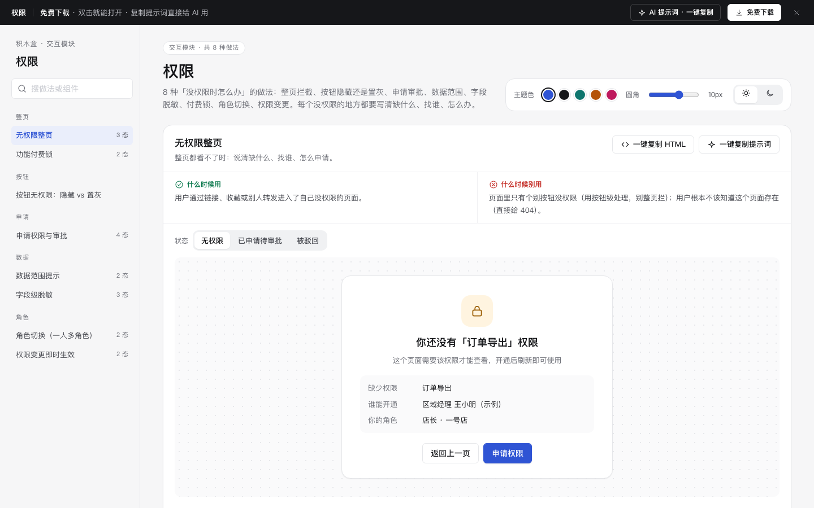

# 权限 · 交互模块

免费下载 · 双击就能打开 · 复制提示词直接给 AI 用。

> 积木盒 · 老岳AI编辑部 · 原型组　|　交互模块（组件 → **模块** → 页面模板）　|　单文件 HTML，离线可用　|　2026-11-10

这是一页「没权限时怎么办」的做法合集：8 种做法，每种都能切状态、能真实操作。原则只有一条：每个没权限的地方都要写清缺什么、找谁、怎么办。

---

## 一、用处

| 项 | 说明 |
|---|---|
| 解决什么 | 原型里权限常常只写一句「无权限的不显示」，上线后用户找不到功能、以为数据丢了、点了才报错。这里把常见的 8 种权限场景都做成能点的演示 |
| 适合谁 | 设计后台、多角色系统、按套餐收费产品的产品经理 |
| 和其他层的关系 | 列表、详情、审批等页面模板里的「没权限」状态，都可以从这里挑做法 |

## 二、做法清单

| # | 做法 | 状态 | 什么时候用 | 什么时候别用 |
|---|---|---|---|---|
| 1 | 无权限整页 | 无权限 / 已申请待审批 / 被驳回 | 通过链接进了没权限的页面 | 只有个别按钮没权限；用户不该知道这个页面存在（给 404） |
| 2 | 按钮无权限：隐藏 vs 置灰 | 并排对比 | 隐藏：永远用不到；置灰 + 说明：知道有这功能、需要开通 | 置灰不说原因；隐藏用户正在找的功能 |
| 3 | 申请权限与审批 | 填写申请 / 审批中 / 已通过 / 已驳回 | 权限要上级审批 | 能自助开通的权限 |
| 4 | 数据范围提示 | 部分范围 / 全部数据 | 不同角色看到的数据范围不同 | 不提示就悄悄少显示 |
| 5 | 字段级脱敏 | 脱敏 / 验证中 / 已显示 | 手机号、身份证等敏感字段，偶尔要看完整 | 用户自己的信息 |
| 6 | 功能付费锁 | 锁定 / 已升级 | 功能按套餐区分 | 用倒计时、名额施压；锁基础功能 |
| 7 | 角色切换 | 店长 / 区域经理 | 一个账号多个角色 | 角色只差一两个按钮 |
| 8 | 权限变更即时生效 | 新增权限 / 权限被收回 | 权限变化时用户正开着页面 | 要求重新登录才生效 |

## 三、用法

1. 下载文件夹，双击 `index.html`。
2. 左侧目录点到想要的做法，点「状态」切换，演示区可以真实操作（申请、验证码 246810、切换角色……）。
3. 右上角换主题色、圆角、明暗，所有演示实时跟着变。
4. **一键复制 HTML**：复制当前状态的 HTML 和所需样式，粘进原型就能显示（交互逻辑用提示词让 AI 补上）。
5. **一键复制提示词**：每种做法都有一条，交给 AI 就能做出带全部状态的同款。

### 页面上的 AI 提示词

页面顶部「AI 提示词 · 一键复制」里有 3 条，高亮的变量点一下就能就地填写：

| # | 提示词 | 什么时候用 |
|---|---|---|
| 1 | 从零生成整套「权限」交互模块 | 想要一套自己的权限交互规范 + 演示 |
| 2 | 把权限交互改成我的业务（变量：系统名称、角色清单、权限、开通人和时效、脱敏字段） | 已经下载，换成自己系统 |
| 3 | 在此基础上加一种权限做法 / 状态（变量：要加的做法、状态清单） | 模块里没有你要的场景 |

## 四、交互说明

| 做法 | 元素 | 交互 | 反馈 |
|---|---|---|---|
| 无权限整页 | 申请权限 | 点击 | 进入「已申请待审批」，写审批人和预计时间；可「催一下」（每天 1 次） |
| 无权限整页 | 被驳回 | — | 写驳回原因，可修改理由重新申请 |
| 按钮置灰 | 置灰按钮 | 悬停、键盘聚焦或点击 | 上方说明「需要什么权限、找谁开通」；不执行操作。用 aria-disabled，键盘能聚焦 |
| 申请权限 | 理由输入框 | 输入 | 实时显示字数；不足 10 字提交时写「还差 N 个字」 |
| 申请权限 | 期限 | 分段选择 | 默认 30 天 |
| 申请权限 | 审批中 | 撤回 / 模拟通过 / 模拟驳回 | 通过后「去改价」直接可用；驳回给替代出路（提价格调整单） |
| 数据范围 | 查看范围 | 点击 | 弹出能看到的门店清单 + 申请扩大范围；Esc 关闭 |
| 字段脱敏 | 查看 | 点击 → 输入 6 位验证码（可粘贴、自动跳格） | 对了：显示完整号码 + 新增一条查看记录；错了：清空重输并说明 |
| 付费锁 | 先不用 / 了解专业版 | 点击 | 先不用：本次不再提示；了解：示例直接开通并显示内容 |
| 角色切换 | 右上角角色 | 点击打开菜单 → 选角色 | 菜单、数据范围立即变化，Toast 写明新的数据范围；Esc 关闭菜单 |
| 权限变更 | 顶部横幅 | 可关闭 | 新增：新按钮短暂高亮；收回：按钮变置灰 + 说明，正在填的内容保留，可存草稿 |

## 五、自检（按《交互设计规范》）

- [x] 每个没权限的地方都写清缺什么、找谁、怎么办，没有只写「暂无权限」
- [x] 每种做法写清「什么时候用 / 什么时候别用」，状态齐全可切换
- [x] 置灰按钮可键盘聚焦并读出原因；菜单和弹出层 Esc 可关闭
- [x] 付费锁写清价格、可随时取消，不用倒计时和名额施压
- [x] 文字对比度 ≥ 4.5:1（浅色、深色都检查）
- [x] 页面上有 3 条 AI 提示词，变量可就地填写
- [x] 无 JS 报错（8 种做法 19 个状态 + 申请 / 校验 / 脱敏验证 / 角色切换 / 付费锁脚本走查）
- [x] 示例数据标「示例」，无真实公司名

---

本模块由老岳AI编辑部·原型组制作，免费下载、修改、用于工作项目。
