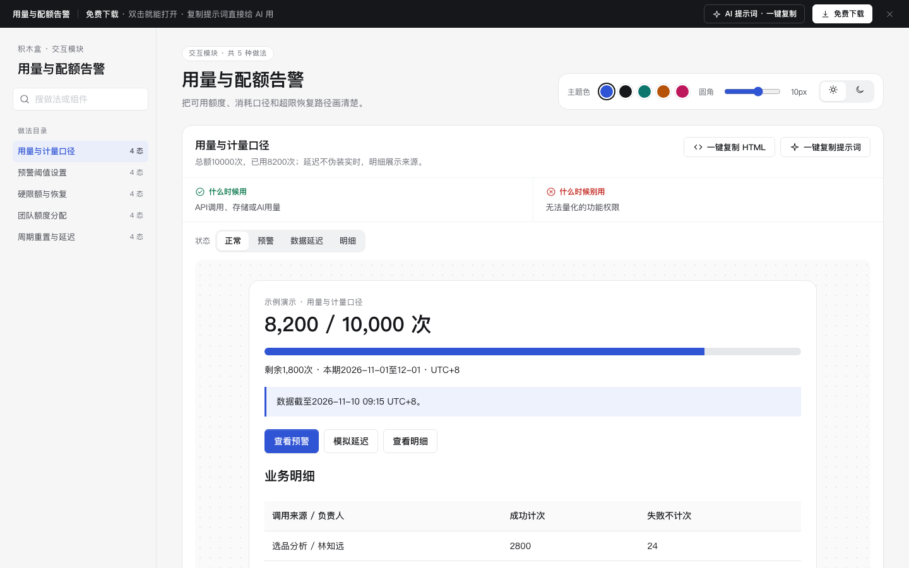

# 用量与配额告警 · 交互模块

免费下载 · 单文件 HTML · 中文 · 离线可用。老岳AI编辑部 · 积木盒 · 原型组。

把可用额度、消耗口径和超限恢复路径画清楚。

## 做法与状态

| 做法 | 全部状态 | 什么时候用 | 什么时候别用 | 交互规则 |
|---|---|---|---|---|
| 用量与计量口径 | 正常,预警,数据延迟,明细 | API调用、存储或AI用量 | 无法量化的功能权限 | 总额10000次，已用8200次；延迟不伪装实时，明细展示来源。 |
| 预警阈值设置 | 编辑,校验错误,通知预览,已保存 | 额度耗尽前提醒管理员 | 不能通知任何人的匿名场景 | 阈值1–99整数；预警不等于硬限额；邮件目标明确且不真实发送。 |
| 硬限额与恢复 | 即将耗尽,额度不足,申请核对,额度恢复 | 达到上限必须阻止消费 | 允许自动超额计费的方案 | 单次需500次，剩余200次时阻止；申请临时1000次后再执行。 |
| 团队额度分配 | 编辑,超分配,分配核对,已保存 | 多个团队共享组织总额 | 每个团队独立计费 | 总额10000，商品研发与门店运营可编辑，另三组固定3000次；五组合计不能超额，非负整数。 |
| 周期重置与延迟 | 本期,下期规则,延迟提示,已刷新 | 月度额度与结转说明 | 无固定结算周期的永久余额 | 显示2026-11-01至12-01 UTC+8，剩余额度不结转；刷新不伪造重置。 |

## 使用

1. 解压 `m-quota.zip`，双击 `index.html`。无需依赖或服务端。
2. 左侧搜索做法，右侧切换状态；演示内按钮、输入和选择可操作。状态按钮是独立情境样例，流程操作会保留当前输入。
3. 右上切换主题、圆角与明暗，偏好保存本机。业务数据只存当前页面内存，刷新清除。
4. 每种做法可复制当前状态 HTML（含样式变量，交互逻辑需由 AI 补齐）与完整做法提示词。
5. 顶部 AI 面板含三条提示词：从零生成、改成我的业务、增加做法/状态；变量可就地填写。
6. 顶部免费下载获取同名 zip。所有数据标示例，不发送真实邀请、不扣费、不请求网络。

## 边界

示例仅为产品原型；实际排班、核销、权限、库存和配额须由服务端校验。状态切换用于查看演示，不代表实际权限可被绕过。
