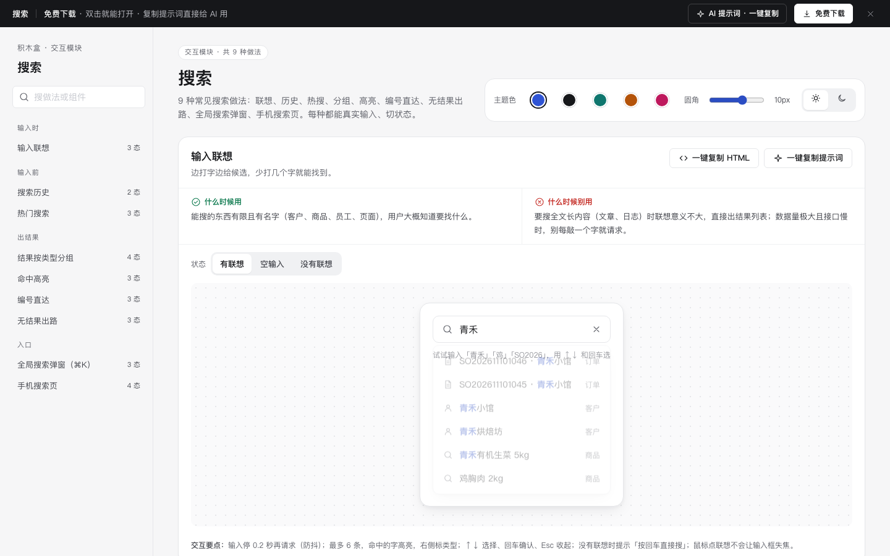

# 搜索 · 交互模块

免费下载 · 双击就能打开 · 复制提示词直接给 AI 用。

> 积木盒 · 老岳AI编辑部 · 原型组　|　交互模块（组件 → **模块** → 页面模板）　|　单文件 HTML，离线可用　|　2026-11-10

这是一页能点的搜索做法合集：9 种常见做法，每种都能真实输入、切状态。挑一种，复制 HTML 粘进你的原型；或者复制提示词，让 AI 换成你能搜的东西。

---

## 一、用处

| 项 | 说明 |
|---|---|
| 解决什么 | 画搜索原型时最容易漏的是：搜之前给什么、搜不到怎么办、键盘怎么操作、单号能不能直接跳。这里每种做法把这些都摆出来了 |
| 适合谁 | 要画后台全局搜索、商品搜索、客服查单、App 搜索页的产品经理 |
| 和页面模板的关系 | 页面模板是整页；模块是其中一块的多种做法，拼页面时从这里挑。「列表 + 详情抽屉」「短视频内容流」都用到这里的做法。 |

## 二、做法清单

| # | 做法 | 状态 | 什么时候用 | 什么时候别用 |
|---|---|---|---|---|
| 1 | 输入联想 | 有联想 / 空输入 / 没有联想 | 能搜的东西有名字、数量有限 | 搜全文长内容；接口慢又每个字都请求 |
| 2 | 搜索历史 | 有历史 / 没有历史 | 同一个人反复搜相同的东西 | 公用电脑；搜索内容敏感 |
| 3 | 热门搜索 | 正常 / 加载中 / 加载失败 | 来逛的内容、商品产品 | 后台工具类；热搜数据没代表性 |
| 4 | 结果按类型分组 | 全部 / 订单 / 客户 / 商品 | 一次能搜到多种东西 | 只有一种类型；类型超过 6 个 |
| 5 | 命中高亮 | 标题命中 / 摘要命中 / 多词命中 | 所有搜索结果 | 大面积黄底色块 |
| 6 | 编号直达 | 普通搜索 / 识别到编号 / 编号不存在 | 有固定格式编号的业务 | 编号格式不固定、容易和普通词混淆 |
| 7 | 无结果出路 | 无结果 / 可能打错字 / 放宽条件能找到 | 所有搜索 | 自动改掉关键词再搜 |
| 8 | 全局搜索弹窗（⌘K） | 关闭 / 打开·最近访问 / 打开·有结果 | PC 后台、文档、工具 | 手机端；只靠快捷键没有可见入口 |
| 9 | 手机搜索页 | 初始 / 联想 / 结果 / 无结果 | App、小程序、手机网页 | 「取消」放左上角；下拉浮层 |

## 三、用法

1. 下载文件夹，双击 `index.html`。
2. 左侧目录点到想要的做法，点「状态」切换看效果，演示区里可以真实输入、点击。
3. 右上角换主题色、圆角、明暗，所有演示实时跟着变。
4. **一键复制 HTML**：复制当前状态的 HTML，自带所需的 CSS 变量和样式，粘进任意 HTML 原型就能显示（交互逻辑用提示词让 AI 补）。
5. **一键复制提示词**：每种做法都有一条，交给 AI 就能做出带全部状态的同款。

### 页面上的 AI 提示词

页面顶部「AI 提示词 · 一键复制」里有 3 条，高亮的变量点一下就能就地填写，复制出来就是填好的完整提示词：

| # | 提示词 | 什么时候用 |
|---|---|---|
| 1 | 从零生成整套「搜索」交互模块 | 想要一份自己的搜索规范 + 演示 |
| 2 | 把搜索改成我的业务（变量：做法、业务名称、角色、类型和字段、编号格式） | 已经下载，换成自己的业务 |
| 3 | 在此基础上加一种做法 / 状态（变量：要加的做法、状态清单） | 模块里没有你要的做法 |

## 四、交互说明

| 做法 | 元素 | 交互 | 反馈 |
|---|---|---|---|
| 输入联想 | 输入框 | 输入停 0.2 秒出联想；↑↓ 选、回车确认、Esc 收起 | 命中字主色加粗；没有联想时提示「按回车直接搜」 |
| 搜索历史 | 历史标签 | 点标签搜索并移到最前；点 × 删一条；「清空」 | 清空先弹确认；没有历史时整块不显示 |
| 热门搜索 | 热词 | 点一下直接搜索并记入历史 | 失败只在这块提示，可「重试」（先骨架再出结果） |
| 结果分组 | Tab | 切类型；关键词改动停 0.26 秒刷新 | Tab 写条数，0 条置灰；「全部」每类 3 条 + 查看全部 |
| 命中高亮 | 输入框 | 多个词用空格分开 | 所有词都命中才出现；每个词都高亮 |
| 编号直达 | 输入框 | 输入完整单号（大小写、空格、横杠都认）回车 | 识别到时出「回车直接打开」卡片；不存在时说清并给「按关键词搜」 |
| 无结果出路 | 出路按钮 | 纠错建议 / 去掉筛选 / 热词 / 告诉我们缺什么 | 提交缺口前校验不为空，提交后 Toast |
| 全局搜索弹窗 | ⌘K / Ctrl+K、触发按钮 | 唤起、↑↓ 选、回车打开、Esc 关闭 | 自动聚焦输入框；焦点锁在弹窗；关闭后回到触发按钮 |
| 手机搜索页 | 取消、热词、键盘搜索键 | 点热词或回车出结果；「取消」返回 | 输入框 16px 防放大；列表行高 ≥ 48px |

## 五、自检（按《交互设计规范》）

- [x] 每种做法的状态齐全，可切换，可真实操作
- [x] 每种做法写清「什么时候用 / 什么时候别用」和交互要点
- [x] 可点元素 PC ≥ 32px、手机演示 ≥ 44px；焦点框清晰；文字对比度 ≥ 4.5:1（浅色、深色都检查）
- [x] 页面上有 3 条 AI 提示词，变量可就地填写，复制有成功反馈
- [x] 无 JS 报错（9 种做法 28 个状态 + 复制 HTML / 提示词 + 明暗切换自测；关键交互脚本走查）
- [x] 示例数据标「示例」，无真实公司名

---

本模块由老岳AI编辑部·原型组制作，免费下载、修改、用于工作项目。

## 本次清理提示词

### 从零构建搜索

请制作「搜索」的单文件离线原型，服务于{{业务名称}}的{{使用角色}}。逐项实现下列做法与状态，不只画静态截图：
输入联想（有联想、空输入、没有联想）；输入停 0.2 秒再请求（防抖）；最多 6 条，命中的字高亮，右侧标类型；↑↓ 选择、回车确认、Esc 收起；没有联想时提示「按回车直接搜」；鼠标点联想不会让输入框失焦。
搜索历史（有历史、没有历史）；只存在本机，最多 10 条，新的在前、重复的提到最前；每条可单独删；「清空」先确认；没有历史时整块不显示，不留空标题。
热门搜索（正常、加载中、加载失败）；前 3 名用主色数字强调；点一下直接搜索并记入历史；加载用骨架不用转圈；失败只在这一块提示并可重试，不影响搜索框使用。
结果按类型分组（全部、订单、客户、商品）；「全部」里每类最多 3 条 + 「查看全部 N 条」；Tab 上写条数，0 条的 Tab 置灰；切 Tab 不清空关键词；改关键词时停在当前 Tab。
命中高亮（标题命中、摘要命中、多词命中）；只改颜色和字重，不加底色块；多个词用空格分开、全部命中才出现、每个词都高亮；大小写、全角半角都认。
编号直达（普通搜索、识别到编号、编号不存在）；大小写、空格、横杠都认（so 2026-1110-1046 也行）；识别到时输入框下方立刻提示「回车直接打开」；编号不存在时说清并给「按关键词搜」出路。
无结果出路（无结果、可能打错字、放宽条件能找到）；标题写清搜了什么；出路按「最可能有用」排：纠错建议 → 去掉筛选能找到几条 → 热门词 → 告诉我们缺什么（一句话提交，提交后反馈）；不清空用户的关键词。
全局搜索弹窗（⌘K）（关闭、打开 · 最近访问、打开 · 有结果）；⌘K / Ctrl+K 唤起，再按一次或 Esc 关闭；打开自动聚焦输入框；↑↓ 选择、回车打开；焦点锁在弹窗内，关闭后回到触发按钮；底部写快捷键。
手机搜索页（初始（历史 + 热搜）、联想、结果、无结果）；进入即聚焦弹键盘；搜索框吸顶，右侧「取消」返回上一页并收起键盘；输入框字号 16px（防止手机自动放大）；列表行高 ≥48px；回车（键盘「搜索」键）出结果。
业务字段：搜索词、搜索范围、最近搜索、结果数量、高亮片段。按{{校验规则}}验证必填、格式与权限；保留搜索目录、主题色、圆角、深浅色、下载和提示词面板，提供真实操作及取消恢复。使用逐行不同的业务演示数据。

### 替换搜索业务数据

将附件「搜索」接入{{业务场景}}，字段映射由{{字段映射}}就地填写。必须保留这些业务做法及状态：
输入联想（有联想、空输入、没有联想）；输入停 0.2 秒再请求（防抖）；最多 6 条，命中的字高亮，右侧标类型；↑↓ 选择、回车确认、Esc 收起；没有联想时提示「按回车直接搜」；鼠标点联想不会让输入框失焦。
搜索历史（有历史、没有历史）；只存在本机，最多 10 条，新的在前、重复的提到最前；每条可单独删；「清空」先确认；没有历史时整块不显示，不留空标题。
热门搜索（正常、加载中、加载失败）；前 3 名用主色数字强调；点一下直接搜索并记入历史；加载用骨架不用转圈；失败只在这一块提示并可重试，不影响搜索框使用。
结果按类型分组（全部、订单、客户、商品）；「全部」里每类最多 3 条 + 「查看全部 N 条」；Tab 上写条数，0 条的 Tab 置灰；切 Tab 不清空关键词；改关键词时停在当前 Tab。
命中高亮（标题命中、摘要命中、多词命中）；只改颜色和字重，不加底色块；多个词用空格分开、全部命中才出现、每个词都高亮；大小写、全角半角都认。
编号直达（普通搜索、识别到编号、编号不存在）；大小写、空格、横杠都认（so 2026-1110-1046 也行）；识别到时输入框下方立刻提示「回车直接打开」；编号不存在时说清并给「按关键词搜」出路。
无结果出路（无结果、可能打错字、放宽条件能找到）；标题写清搜了什么；出路按「最可能有用」排：纠错建议 → 去掉筛选能找到几条 → 热门词 → 告诉我们缺什么（一句话提交，提交后反馈）；不清空用户的关键词。
全局搜索弹窗（⌘K）（关闭、打开 · 最近访问、打开 · 有结果）；⌘K / Ctrl+K 唤起，再按一次或 Esc 关闭；打开自动聚焦输入框；↑↓ 选择、回车打开；焦点锁在弹窗内，关闭后回到触发按钮；底部写快捷键。
手机搜索页（初始（历史 + 热搜）、联想、结果、无结果）；进入即聚焦弹键盘；搜索框吸顶，右侧「取消」返回上一页并收起键盘；输入框字号 16px（防止手机自动放大）；列表行高 ≥48px；回车（键盘「搜索」键）出结果。
逐一核对搜索词、搜索范围、最近搜索、结果数量、高亮片段的来源、默认值与提交范围。将演示值替换为{{业务数据}}，输入变更后重新校验；说明确认前后的数据变化与失败保留内容。交付可离线运行的完整HTML与字段说明。

### 核对搜索交互边界

请对「搜索」开展交互边界修订，重点场景为{{边界场景}}，验收条件为{{验收条件}}。以下是本模块必须逐项走通的做法和状态清单：
输入联想（有联想、空输入、没有联想）；输入停 0.2 秒再请求（防抖）；最多 6 条，命中的字高亮，右侧标类型；↑↓ 选择、回车确认、Esc 收起；没有联想时提示「按回车直接搜」；鼠标点联想不会让输入框失焦。
搜索历史（有历史、没有历史）；只存在本机，最多 10 条，新的在前、重复的提到最前；每条可单独删；「清空」先确认；没有历史时整块不显示，不留空标题。
热门搜索（正常、加载中、加载失败）；前 3 名用主色数字强调；点一下直接搜索并记入历史；加载用骨架不用转圈；失败只在这一块提示并可重试，不影响搜索框使用。
结果按类型分组（全部、订单、客户、商品）；「全部」里每类最多 3 条 + 「查看全部 N 条」；Tab 上写条数，0 条的 Tab 置灰；切 Tab 不清空关键词；改关键词时停在当前 Tab。
命中高亮（标题命中、摘要命中、多词命中）；只改颜色和字重，不加底色块；多个词用空格分开、全部命中才出现、每个词都高亮；大小写、全角半角都认。
编号直达（普通搜索、识别到编号、编号不存在）；大小写、空格、横杠都认（so 2026-1110-1046 也行）；识别到时输入框下方立刻提示「回车直接打开」；编号不存在时说清并给「按关键词搜」出路。
无结果出路（无结果、可能打错字、放宽条件能找到）；标题写清搜了什么；出路按「最可能有用」排：纠错建议 → 去掉筛选能找到几条 → 热门词 → 告诉我们缺什么（一句话提交，提交后反馈）；不清空用户的关键词。
全局搜索弹窗（⌘K）（关闭、打开 · 最近访问、打开 · 有结果）；⌘K / Ctrl+K 唤起，再按一次或 Esc 关闭；打开自动聚焦输入框；↑↓ 选择、回车打开；焦点锁在弹窗内，关闭后回到触发按钮；底部写快捷键。
手机搜索页（初始（历史 + 热搜）、联想、结果、无结果）；进入即聚焦弹键盘；搜索框吸顶，右侧「取消」返回上一页并收起键盘；输入框字号 16px（防止手机自动放大）；列表行高 ≥48px；回车（键盘「搜索」键）出结果。
围绕业务字段搜索词、搜索范围、最近搜索、结果数量、高亮片段检查无输入、非法值、取消、重复操作及失败恢复；每条路径写出触发、反馈和恢复位置。保持500px宽度、浅深色对比度及至少24px触控目标，返回完整代码和验收记录。

## 第2轮完整实测清单修订（fix14b）

修正编号命中说明文字色；命中高亮与热搜序号使用修正后的主题前景；历史词从span改成button并保留data-use事件，至少32px（窄屏44px）；滑块44px。

本轮保留全部业务内容与提示词。已通过脚本语法与静态增量检查；本轮未运行真实浏览器验收，详见根目录 `codex_交付_fix14b.md`。

状态：已通过浏览器验收（1440/500 宽 0 报错、0 溢出、对比度与触控达标；标准外壳与跨目录比对通过）
