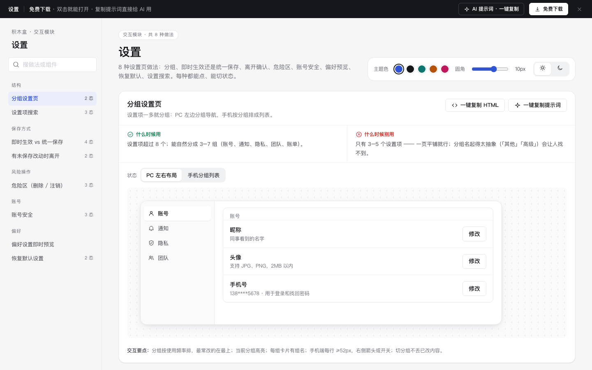

# 设置 · 交互模块

免费下载 · 双击就能打开 · 复制提示词直接给 AI 用。

> 积木盒 · 老岳AI编辑部 · 原型组　|　交互模块（组件 → **模块** → 页面模板）　|　单文件 HTML，离线可用　|　2026-11-10

这是一页能点的设置页做法合集：8 种做法，每种都能切状态、能真实操作。挑一种，复制 HTML 粘进你的原型；或者复制提示词，让 AI 改成你的设置项。

---

## 一、用处

| 项 | 说明 |
|---|---|
| 解决什么 | 设置页最容易吵架的地方：改了要不要点保存、保存失败怎么办、改了没保存就走怎么办、删除空间这种大事怎么防手滑。这里每种做法把这些状态都摆出来了 |
| 适合谁 | 要画账号设置、系统设置、团队设置的产品经理 |
| 和页面模板的关系 | 页面模板是整页；模块是其中一块的多种做法，拼页面时从这里挑 |

## 二、做法清单

| # | 做法 | 状态 | 什么时候用 | 什么时候别用 |
|---|---|---|---|---|
| 1 | 分组设置页 | PC 左右布局 / 手机分组列表 | 设置项 > 8 个，能分成 3–7 组 | 只有 3–5 项，一页平铺 |
| 2 | 即时生效 vs 统一保存 | 即时生效 / 统一保存 / 保存中 / 保存失败回滚 | 即时：只影响自己的；统一：影响别人、要花钱的 | 同一页混用两种又不说明 |
| 3 | 有未保存改动时离开 | 无改动 / 有改动 | 统一保存的页面、长表单 | 没有改动时别弹确认 |
| 4 | 危险区（删除 / 注销） | 默认 / 输入确认 / 冷静期中 | 删除空间、注销账号、转让所有权 | 删一条普通记录（用 Toast 撤销） |
| 5 | 账号安全 | 概览 / 改密码 / 登录设备 | 有账号体系的产品 | 规则复杂又不给强度提示 |
| 6 | 偏好设置即时预览 | 默认（改了即预览） | 主题、语言、时区、日期格式 | 预览与真实效果不一致 |
| 7 | 恢复默认设置 | 有自定义 / 已恢复 | 设置项多、容易改乱 | 会删数据的「重置」（放危险区） |
| 8 | 设置项搜索 | 默认 / 有结果 / 无结果 | 设置项 > 30 个 | 设置项很少 |

## 三、用法

1. 下载文件夹，双击 `index.html`。
2. 左侧目录点到想要的做法，点「状态」切换，演示区里可以真实操作。
3. 右上角换主题色、圆角、明暗，所有演示实时跟着变。
4. **一键复制 HTML**：复制当前状态的 HTML，自带所需 CSS 变量和样式，粘进任意 HTML 原型就能显示（交互逻辑用提示词让 AI 补）。
5. **一键复制提示词**：每种做法一条，交给 AI 就能做出带全部状态的同款。

### 页面上的 AI 提示词

页面顶部「AI 提示词 · 一键复制」里有 3 条，高亮变量点一下就能填，复制出来就是填好的完整提示词：

| # | 提示词 | 什么时候用 |
|---|---|---|
| 1 | 从零生成整套「设置」交互模块 | 想要一份自己的设置页规范 + 演示 |
| 2 | 把设置页改成我的产品（变量：做法、产品名称、角色、设置项清单、危险操作） | 已下载，换成自己的设置项 |
| 3 | 在此基础上加一种做法 / 状态（变量：要加的做法、状态清单） | 模块里没有你要的做法 |

## 四、交互说明

| 做法 | 元素 | 交互 | 反馈 |
|---|---|---|---|
| 分组设置页 | 左侧分组 | 点击切换 | 当前分组白底高亮；开关切换即生效并 Toast |
| 即时生效 | 开关 | 点击 | 立刻切换、后台保存；失败时开关自动弹回原位 + Toast 说原因（「保存失败回滚」状态第一次切换演示失败） |
| 统一保存 | 底部保存条 | 改任何一项 | 显示「有 N 项未保存」，保存和撤销改动变可点；保存中按钮转圈禁用 |
| 离开确认 | 返回按钮 | 有改动时点击 | 弹窗三选一：保存并离开（主）/ 不保存离开 / 继续编辑；无改动直接返回不弹 |
| 危险区 | 删除空间 | 点击 → 弹窗列出删除后果 | 输入空间名称完全一致后删除按钮才可点；确认后进入 7 天冷静期，写清截止时间，可一键撤销 |
| 账号安全 | 新密码 | 输入 | 强度条实时变化（弱 / 中 / 强）；保存时校验长度、字母数字、两次一致 |
| 账号安全 | 设备下线 | 点「下线」 | 先确认；本机不能下线 |
| 偏好 | 下拉选择 | 改语言 / 主题 / 时区 / 日期格式 | 预览区立刻变化 |
| 恢复默认 | 恢复默认按钮 | 点击 → 确认列出将改回的项 | 恢复后 Toast 5 秒内可撤销；改过的项标「已修改」 |
| 设置搜索 | 搜索框 | 输入即搜（停 0.2 秒） | 结果写「分组 › 设置项」并高亮命中；开关可直接改；无结果给常用入口和反馈 |

## 五、自检（按《交互设计规范》）

- [x] 每种做法的状态齐全，可切换，能真实操作
- [x] 每种做法写清「什么时候用 / 什么时候别用」
- [x] 危险操作：说清后果、输入确认、冷静期可撤销
- [x] 可点元素 ≥ 32px（开关 44×26 + 行高 ≥ 52px）；焦点框清晰；对比度 ≥ 4.5:1
- [x] 弹窗：Esc / 点遮罩关闭、焦点锁定、关闭后焦点回到触发处
- [x] 页面上有 3 条 AI 提示词，变量可就地填写，复制有成功反馈
- [x] 无 JS 报错（8 种做法 20 个状态自测 OK + 关键交互脚本走查）
- [x] 示例数据标「示例」，无真实公司名

---

本模块由老岳AI编辑部·原型组制作，免费下载、修改、用于工作项目。
