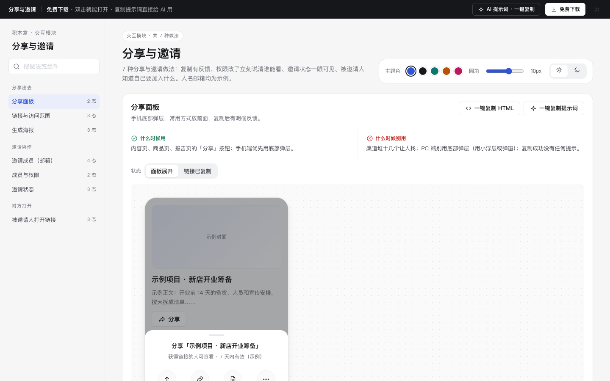

# 分享与邀请 · 交互模块

免费下载 · 双击就能打开 · 复制提示词直接给 AI 用。

> 积木盒 · 老岳AI编辑部 · 原型组　|　交互模块（组件 → **模块** → 页面模板）　|　单文件 HTML，离线可用　|　2026-11-10

这是一页能点的「分享与邀请」做法合集：7 种做法 20 个状态，从分享面板、链接范围、海报，到邀请成员、改权限、跟进邀请、对方打开链接。挑一种，复制 HTML 粘进你的原型；或者复制提示词，让 AI 改成你的产品。

---

## 一、用处

| 项 | 说明 |
|---|---|
| 解决什么 | 分享邀请最常见的坑：复制了没反馈、改成公开不提醒、邮箱一个个填、改角色还要点保存、最后一个管理员把自己降级、邀请发出去就看不到、对方打开链接不知道是谁邀请来干什么 |
| 适合谁 | 要画内容分享、团队协作、供应商 / 客户邀请流程的产品经理 |
| 和页面模板的关系 | 页面模板是整页；模块是其中一块的多种做法，拼页面时从这里挑（`c-feed` = 评论与互动 + 分享 + 搜索） |

## 二、做法清单

| # | 做法 | 状态 | 什么时候用 | 什么时候别用 |
|---|---|---|---|---|
| 1 | 分享面板 | 面板展开 / 链接已复制 | 手机端内容页、商品页的「分享」 | 渠道堆十几个；PC 端用底部弹层 |
| 2 | 链接与访问范围 | 仅成员可看 / 获得链接的人可查看 / 已关闭链接 | 文档、报告、看板发链接给人看 | 默认就公开；改公开不提醒 |
| 3 | 生成海报 | 生成中 / 已生成 / 生成失败 | 发到不能点链接的地方 | 把海报当唯一方式；失败不给替代 |
| 4 | 邀请成员（邮箱） | 输入中 / 有格式不对的邮箱 / 发送中 / 已发送 | 邀请同事进空间、项目 | 一次只能填一个；默认给最高权限 |
| 5 | 成员与权限 | 成员列表 / 最后一位管理员 | 成员管理页、分享弹窗下半部分 | 改角色还要点保存；移除不确认 |
| 6 | 邀请状态 | 有待接受 / 有已过期 / 全部已接受 | 发出邀请后要跟进 | 「再次发送」不限次数；过期仍显示待接受 |
| 7 | 被邀请人打开链接 | 未登录 / 已登录可加入 / 邀请已失效 | 所有邀请、分享链接落地页 | 打开就是登录页；失效只写 404 |

## 三、用法

1. 下载文件夹，双击 `index.html`。
2. 左侧目录点到想要的做法，点「状态」切换，演示区里可以真实操作。
3. 右上角换主题色、圆角、明暗，所有演示实时跟着变。
4. **一键复制 HTML**：复制当前状态的 HTML，自带所需 CSS 变量和样式，粘进任意 HTML 原型就能显示（交互逻辑用提示词让 AI 补）。
5. **一键复制提示词**：每种做法一条，交给 AI 就能做出带全部状态的同款。

### 页面上的 AI 提示词

| # | 提示词 | 什么时候用 |
|---|---|---|
| 1 | 从零生成整套「分享与邀请」交互模块 | 想要一份自己的分享邀请规范 + 演示 |
| 2 | 把分享与邀请改成我的产品（变量：产品名称、对象、分享方式清单、角色清单、规则） | 已下载，换成自己的角色和规则 |
| 3 | 在此基础上加一种做法 / 状态（变量：要加的做法、状态清单） | 比如「邀请好友得奖励」 |

## 四、交互说明

| 做法 | 元素 | 交互 | 反馈 |
|---|---|---|---|
| 分享面板 | 分享按钮 / 渠道按钮 | 点击 | 底部弹层滑出；复制链接后按钮变绿写「已复制」+ Toast；点遮罩、取消或 Esc 收起 |
| 链接范围 | 「谁能打开」下拉 | 切换 | 立即生效，一句话说清现在谁能看；切公开先确认「不用登录也能看」 |
| 链接范围 | 关闭链接 | 点击 → 确认 | 旧链接立即失效；可「重新开启」生成新链接 |
| 生成海报 | 海报 | 进入 | 同尺寸骨架约 1.6 秒后出图；「保存图片」主、「复制链接」次；失败给「重试」+「复制链接」 |
| 邀请成员 | 邮箱输入 | 回车 / 逗号 / 空格 / 粘贴一串 | 自动拆成标签；格式不对或已是成员的标红并写原因；按钮「邀请 N 人」实时变，有错时禁用；Backspace 删最后一个 |
| 邀请成员 | 邀请按钮 | 点击 | 转圈禁用 → 写清发了几人、7 天有效 |
| 成员与权限 | 角色下拉 | 切换 | 立即生效，Toast 5 秒内可撤销；最后一位管理员下拉置灰并写原因 |
| 成员与权限 | 移除 | 点击 → 确认 | 写清对方失去什么、TA 的内容保留 |
| 邀请状态 | 再次发送 / 撤回 | 点击 | 再发后 1 小时内置灰；撤回先确认；过期的给「重新邀请」 |
| 被邀请人 | 登录后加入 / 加入 | 点击 | 登录后回到本页；加入中转圈 → 已加入；失效时「申请加入」通知邀请人 |

## 五、自检（按《交互设计规范》）

- [x] 每种做法的状态齐全，可切换，能真实操作
- [x] 每种做法写清「什么时候用 / 什么时候别用」
- [x] 选择优于输入：权限默认「可编辑」、有效期默认 7 天、粘贴一串邮箱自动拆分
- [x] 状态联动：邀请人数、按钮可用、错误提示随输入实时变
- [x] 危险操作（公开、关闭链接、移除、撤回）先确认；改角色可撤销
- [x] 可点元素 ≥ 32px（手机面板 ≥ 44px）；焦点框清晰；对比度 ≥ 4.5:1
- [x] 弹窗：Esc / 点遮罩关闭、焦点锁定、关闭后焦点回到触发处
- [x] 页面上有 3 条 AI 提示词，变量可就地填写
- [x] 无 JS 报错（7 种做法 20 个状态自测 OK）
- [x] 人名邮箱均为示例，无真实公司名和品牌

---

本模块由老岳AI编辑部·原型组制作，免费下载、修改、用于工作项目。
