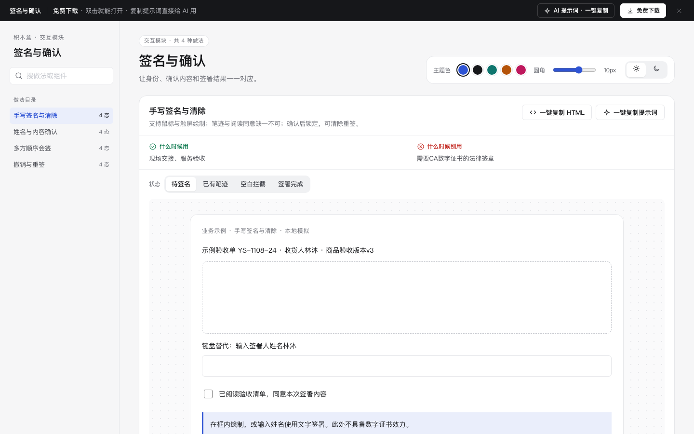

# 签名与确认 · 交互模块

免费下载 · 中文单文件HTML · 离线可用 · 老岳AI编辑部 · 积木盒。

让身份、确认内容和签署结果一一对应。 所有数据均为业务示例，逐行独立；日期固定为2026年11月，时区UTC+8。

## 做法与状态

| 做法 | 状态 | 什么时候用 | 什么时候别用 | 规则 |
|---|---|---|---|---|
| 手写签名与清除 | 待签名,已有笔迹,空白拦截,签署完成 | 现场交接、服务验收 | 需要CA数字证书的法律签章 | 支持鼠标与触屏绘制；笔迹与阅读同意缺一不可；确认后锁定，可清除重签。 |
| 姓名与内容确认 | 待确认,核对摘要,身份错误,确认完成 | 收货人与交接人确认 | 需要权威身份核验的远程合同 | 示例身份必须与指定收货人一致；内容版本固定；修改姓名使核对失效。 |
| 多方顺序会签 | 第一方待签,第二方待签,顺序阻断,全部完成 | 采购与仓库顺序验收 | 任一人签署即可的场景 | 第二方不能越过第一方；分别显示身份和签署时间，不代替对方签署。 |
| 撤销与重签 | 已签记录,撤销确认,理由缺失,已撤销 | 验收内容更正后的重新确认 | 法规要求不可撤销的记录 | 撤销理由必填，旧签名留痕失效，创建新版本后重新签署。 |

## 使用

1. 解压 `m-signature.zip`，双击 `index.html`，无需服务端或外部资源。
2. 左侧目录可搜索，右侧切状态。状态按钮加载独立样例；做法内部操作保留当前输入。小屏目录折叠，页面顺序浏览。
3. 顶部免费下载本模块zip，右上调整主题色、圆角、明暗；偏好保存本机。业务数据仅当前内存，刷新清除。
4. 每种做法复制当前HTML和所需样式；为静态片段，交互可用同区提示词交给AI补齐。
5. 顶部AI提示词面板含从零生成、改成我的业务、增加做法/状态3条，变量可填写，复制有反馈。

## 交互与边界

- 所有提交先校验，错误指出修改方式；核对类输入变化须重新核对。取消不提交，异步操作期间避免重复。
- 失败重试保留业务输入；确认动作提供明确结果。状态预览的成功样例不代表真实业务已经执行。
- 打印使用系统对话框；取消与完成由系统决定，不伪造打印完成。CSV下载为真实本地示例文件，其余业务提交均为本地模拟。
- 不上传附件、不发送通知或消息、不执行CA签章、不访问真实资源预约或Agent后端，不变更真实版本或权限。
- 真实系统须在服务端实现权限、并发锁、身份核验、幂等、审计和业务持久化，页面演示不能代替这些能力。
- 手写签名支持鼠标和触屏，另有姓名输入供键盘使用；示例不具备数字证书效力。

## 浏览器验收结论（2026-11-11 原型组）

通过，可以上线。

- [x] Chrome gtest：4 项 / 16 态全部切换、复制片段与提示词生成、明暗切换，输出 OK。
- [x] 逐态打开（16 态，浅色 + 深色各一遍）：0 个 JS 报错。
- [x] 布局：1440 / 1280 / 500 三种宽度都不横向滚动。
- [x] 对比度：所有可见文字逐态自动检测（正文 ≥4.5:1、大字 ≥3:1），浅色、深色全部达标。
- [x] 触控尺寸：所有按钮、链接、输入框、Tab 都 ≥24px。
- [x] AI 提示词面板：顶部按钮打开，3 条提示词可展开、可复制（出现「已复制」反馈）。
- [x] 数据：逐行不同、贴合业务（单号、品名、金额、人员各不相同），不是批量复制的假数据。
- [x] DOM 自检复跑：断言全部通过，脚本错误 0（`dom-validation.json`）。
- [x] 封面为真实截图 cover.png（1440×900）。

验收时修了：
- 每个做法的操作区原来全是同级描边按钮，没有主操作；改为每行第一个前进类操作用主色按钮（取消 / 撤销 / 清除 / 模拟 / 只看等不升级），与 m-form 标杆一致。

复验命令：`bash _kit/atest.sh m-signature 1440`（另跑 1280、500）、`bash _kit/gtest.sh m-signature`、`bash _kit/shot.sh m-signature "" cover.png 1440 900`。
