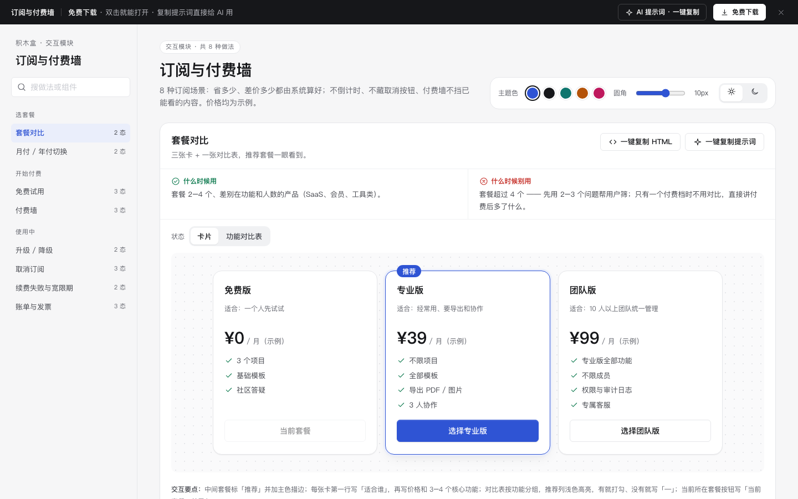

# 订阅与付费墙 · 交互模块

免费下载 · 双击就能打开 · 复制提示词直接给 AI 用。

> 积木盒 · 老岳AI编辑部 · 原型组　|　交互模块（组件 → **模块** → 页面模板）　|　单文件 HTML，离线可用　|　2026-11-10

这是一页能点的「订阅与付费墙」做法合集：8 种做法 20 个状态，从选套餐、试用、付费墙到升降级、取消、续费失败、开票。挑一种，复制 HTML 粘进你的原型；或者复制提示词，让 AI 改成你的套餐。

---

## 一、用处

| 项 | 说明 |
|---|---|
| 解决什么 | 订阅最招投诉的几处：年付到底省多少不写清、试用到期偷偷扣费、付费墙把已读内容盖住、取消按钮藏起来、扣款一失败立刻停用。这里每种做法给出不施压、把钱说清楚的版本 |
| 适合谁 | 要画 SaaS 套餐页、会员页、内容付费、工具类订阅的产品经理 |
| 和页面模板的关系 | 页面模板是整页；模块是其中一块的多种做法，拼页面时从这里挑 |

## 二、做法清单

| # | 做法 | 状态 | 什么时候用 | 什么时候别用 |
|---|---|---|---|---|
| 1 | 套餐对比 | 卡片 / 功能对比表 | 套餐 2–4 个、差别在功能和人数 | 超过 4 个先问问题筛；只有一个付费档直接讲多了什么 |
| 2 | 月付 / 年付切换 | 月付 / 年付 | 同时有月付年付且年付有折扣 | 年付没折扣；默认选年付让人误付一整年 |
| 3 | 免费试用 | 试用中 / 3 天后到期 / 已到期 | 要用一段时间才知道值不值 | 先绑卡又不说清到期扣费 |
| 4 | 付费墙 | 未触发 / 触发 / 已关闭 | 有明确免费额度（读前 30%、每月 3 次导出） | 没看到价值就弹全屏墙；盖住已读内容；关不掉 |
| 5 | 升级 / 降级 | 升级 / 降级 | 已付费用户换套餐 | 降级立刻生效导致数据超限丢失 |
| 6 | 取消订阅 | 确认取消 / 挽留 / 已取消 | 所有自动续费订阅 | 多轮挽留、「仍要取消」做成灰色小字、要打电话才能取消 |
| 7 | 续费失败与宽限期 | 宽限期 / 已暂停 | 自动续费；卡过期、余额不足常见 | 扣款一失败立刻停用、锁数据、红色全屏警告 |
| 8 | 账单与发票 | 有账单 / 开票中 / 没有账单 | 所有付费订阅，尤其要报销的企业用户 | 只发邮件不留底；开票让用户重填抬头税号 |

## 三、用法

1. 下载文件夹，双击 `index.html`。
2. 左侧目录点到想要的做法，点「状态」切换，演示区里可以真实操作。
3. 右上角换主题色、圆角、明暗，所有演示实时跟着变。
4. **一键复制 HTML**：复制当前状态的 HTML，自带所需 CSS 变量和样式，粘进任意 HTML 原型就能显示（交互逻辑用提示词让 AI 补）。
5. **一键复制提示词**：每种做法一条，交给 AI 就能做出带全部状态的同款。

### 页面上的 AI 提示词

页面顶部「AI 提示词 · 一键复制」里有 3 条，高亮变量点一下就能填，复制出来就是填好的完整提示词：

| # | 提示词 | 什么时候用 |
|---|---|---|
| 1 | 从零生成整套「订阅与付费墙」交互模块 | 想要一份自己的订阅规范 + 演示 |
| 2 | 把订阅改成我的产品（变量：产品名称、角色、套餐清单、试用规则、规则） | 已下载，换成自己的套餐和价格 |
| 3 | 在此基础上加一种做法 / 状态（变量：要加的做法、状态清单） | 模块里没有你要的做法，比如按人数计费 |

## 四、交互说明

| 做法 | 元素 | 交互 | 反馈 |
|---|---|---|---|
| 套餐对比 | 套餐卡 / 对比表 | 切换视图 | 中间套餐标「推荐」+ 主色描边；每卡首行写「适合谁」；对比表推荐列浅色高亮，没有写「—」；当前套餐按钮置灰写「当前套餐」 |
| 月付 / 年付 | 切换按钮 | 点击 | 默认月付；切年付后显示「¥X / 年」+「比月付省 ¥Y，相当于 N 个月不要钱」，由月价 × 12 − 年价算出 |
| 免费试用 | 开通说明 | — | 写清试用截止时刻、到期扣多少、随时可取消；到期前 3 天站内提醒一次；取消试用走二次确认，确认后 Toast「已取消，不会扣款」 |
| 付费墙 | 正文 + 付费卡 | 读到额度位置 | 正文渐隐，付费卡出现在正文下方（不覆盖）；可关闭，关闭后一行轻提示「还有 70% 内容，开通后可读」 |
| 升级 / 降级 | 确认弹层 | 选新套餐 | 升级展示差价公式「(新月价 − 旧月价) × 剩余天数 ÷ 30」并立即生效；降级写清生效日期和超限部分怎么处理 |
| 取消订阅 | 取消流程 | 点击取消 | 先问原因（可跳过）→ 只出现一次挽留（降级或暂停 1 个月），「仍要取消」同样大小 → 写清可用到哪天、不会再扣款，给「恢复订阅」 |
| 续费失败 | 顶部横幅 | — | 黄色横幅写失败日期、原因、宽限截止日，期间照常使用 +「更新支付方式」；宽限过后只读、数据保留，付款后立即恢复 |
| 账单与发票 | 账单列表 | 点「申请发票」 | 自动带上次抬头和税号，确认后变「开票中 · 预计 1 个工作日内发到邮箱」；无账单时说明首次扣款后出现 |

## 五、自检（按《交互设计规范》）

- [x] 每种做法的状态齐全，可切换，能真实操作
- [x] 每种做法写清「什么时候用 / 什么时候别用」
- [x] 计算交给系统：年付省多少、升级差价都由系统算并给公式
- [x] 不施压：不倒计时、挽留只一次、取消按钮与挽留同样大小、付费墙不盖已读内容
- [x] 开票信息自动带上次，无多余输入
- [x] 可点元素 ≥ 32px；焦点框清晰；对比度 ≥ 4.5:1
- [x] 弹窗：Esc / 点遮罩关闭、焦点锁定、关闭后焦点回到触发处
- [x] 页面上有 3 条 AI 提示词，变量可就地填写，复制有成功反馈
- [x] 无 JS 报错（8 种做法 20 个状态自测 OK）
- [x] 示例数据标「示例」，无真实公司名和品牌

---

本模块由老岳AI编辑部·原型组制作，免费下载、修改、用于工作项目。

状态：已通过浏览器验收（1440/500 宽 0 报错、0 溢出、对比度与触控达标；标准外壳与跨目录比对通过）
