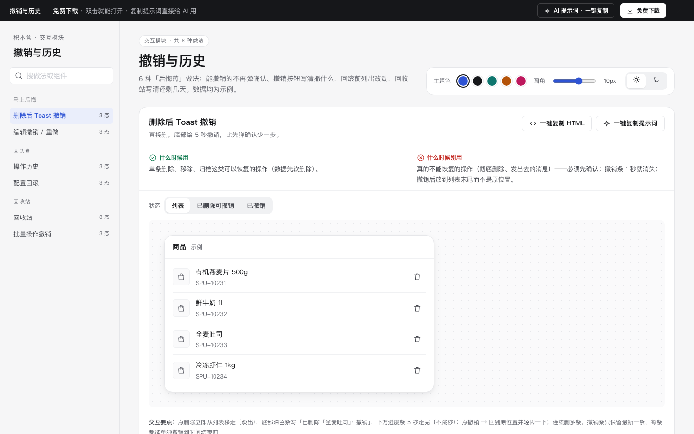

# 撤销与历史 · 交互模块

免费下载 · 双击就能打开 · 复制提示词直接给 AI 用。

> 积木盒 · 老岳AI编辑部 · 原型组　|　交互模块（组件 → **模块** → 页面模板）　|　单文件 HTML，离线可用　|　2026-11-10

这是一页能点的「撤销与历史」做法合集：6 种做法 18 个状态，每种都能切状态、能真实操作。6 种「后悔药」做法：能撤销的不再弹确认、撤销按钮写清撤什么、回滚前列出改动、回收站写清还剩几天。数据均为示例。 挑一种，复制 HTML 粘进你的原型；或者复制提示词，让 AI 改成你的业务。

---

## 一、用处

| 项 | 说明 |
|---|---|
| 解决什么 | 「后悔药」最常见的坑：能恢复的删除也弹确认、撤销条一闪就没、撤销按钮不说撤什么、历史只写「修改了商品」、回滚不说会改回哪些值、回收站不写多久清除、批量操作部分失败只写「失败」 |
| 适合谁 | 要画商品 / 价格 / 配置后台、协作工具、文件管理的产品经理 |
| 和页面模板的关系 | 页面模板是整页；模块是其中一块的多种做法（b-list-drawer 的删除与批量、各类配置页的回滚从这里挑） |

## 二、做法清单

| # | 做法 | 状态 | 什么时候用 | 什么时候别用 |
|---|---|---|---|---|
| 1 | 删除后 Toast 撤销 | 列表 / 已删除可撤销 / 已撤销 | 单条删除、移除、归档这类可以恢复的操作（数据先软删除）。 | 真的不能恢复的操作（彻底删除、发出去的消息）——必须先确认；撤销条 1 秒就消失；撤销后放到列表末尾而不是原位置。 |
| 2 | 编辑撤销 / 重做 | 默认 / 有可撤销 / 已到最早一步 | 设计、排版、表格、表单配置等连续编辑的场景。 | 撤销按钮只有一个箭头，用户不知道会撤掉什么；撤销到头了还能点；保存后撤销记录清空却不说明。 |
| 3 | 操作历史 | 有记录 / 只看我的 / 没有记录 | 多人协作的后台（商品、价格、配置），出问题要追查和回退。 | 只记录「修改了商品」不写改了什么；历史只能看不能撤回；按 ID 显示人而不是名字。 |
| 4 | 配置回滚 | 版本列表 / 回滚确认 / 已回滚 | 价格规则、运费规则、权限配置、上线发布这类「改错了影响面大」的配置。 | 回滚只给一个按钮，不说会改回哪些值；回滚直接覆盖、当前配置不留底；回滚不记录谁做的。 |
| 5 | 回收站 | 有内容 / 即将清除 / 空 | 删除后可能要找回的东西：商品、文件、文档、客户资料。 | 回收站不写多久自动清除；彻底删除不确认；恢复后不告诉用户恢复到了哪里。 |
| 6 | 批量操作撤销 | 执行中 / 已完成可撤销 / 部分失败 | 批量下架、批量改价、批量分配这类一次动很多条的操作。 | 批量操作没有进度、不能中途取消；部分失败只写「操作失败」；撤销只能一条条撤。 |

## 三、用法

1. 下载文件夹，双击 `index.html`。
2. 左侧目录点到想要的做法，点「状态」切换，演示区里可以真实操作。
3. 右上角换主题色、圆角、明暗，所有演示实时跟着变。
4. **一键复制 HTML**：复制当前状态的 HTML，自带所需 CSS 变量和样式，粘进任意 HTML 原型就能显示（交互逻辑用提示词让 AI 补）。
5. **一键复制提示词**：每种做法一条，交给 AI 就能做出带全部状态的同款。

### 页面上的 AI 提示词

页面顶部「AI 提示词 · 一键复制」里有 3 条，高亮变量点一下就能填，复制出来就是填好的完整提示词：

| # | 提示词 | 什么时候用 |
|---|---|---|
| 1 | 从零生成整套「撤销与历史」交互模块 | 想要一份自己的撤销与历史规范 + 演示 |
| 2 | 把撤销与历史改成我的产品（变量：产品名称、对象、规则、需确认的操作、字段清单） | 已下载，换成自己的数据和规则 |
| 3 | 在此基础上加一种做法 / 状态（变量：要加的做法、状态清单） | 模块里没有你要的做法 |

## 四、交互说明

| 做法 | 元素 → 交互 → 反馈 |
|---|---|
| 删除后 Toast 撤销 | 点删除立即从列表移走（淡出），底部深色条写「已删除「全麦吐司」· 撤销」，下方进度条 5 秒走完（不跳秒）；点撤销 → 回到原位置并轻闪一下；连续删多条，撤销条只保留最新一条，每条都能单独撤销到时间结束前。 |
| 编辑撤销 / 重做 | 工具栏「撤销」「重做」按钮旁直接写下一步会撤什么（「撤销：改颜色」）；Ctrl/⌘+Z 撤销、Ctrl/⌘+Shift+Z 重做；没有可撤销 / 重做时按钮置灰；做了新操作后重做记录清空；保留最近 50 步。 |
| 操作历史 | 按天分组，每条：头像、名字、时间、一句话写清改了什么（含旧值 → 新值）；可撤回的操作给「撤回这一步」，撤回前确认并说明影响，撤回本身也记一条历史；顶部「全部 / 只看我的」切换；没有记录时写清「最近 90 天没有操作」。 |
| 配置回滚 | 版本列表写版本号、时间、操作人，当前版本标「当前」；点「回滚到此版本」先展示对比表：只列会变的字段（旧值红色划线 → 新值绿色），不变的字段折叠；确认后生成新版本 v5（内容 = v3），原 v4 保留可再回滚。 |
| 回收站 | 顶部写「删除的内容保留 30 天，到期自动清除」；每条写删除人、删除时间、「还剩 N 天」，3 天内到期的标红并置顶；「恢复」直接恢复并 Toast「已恢复到 商品列表」；「彻底删除」二次确认、写明不能找回；支持全选批量恢复；空时写清楚。 |
| 批量操作撤销 | 执行中：进度条 +「已处理 5 / 12」+「取消」（已处理的保留并说明）；完成：写「已下架 12 个商品」+「整批撤销」，撤销保留 10 分钟（写到几点）；部分失败：写「10 个成功，2 个失败」，失败项列出原因，「只重试失败的 2 个」。 |

## 五、自检（按《交互设计规范》）

- [x] 每种做法的状态齐全，可切换，能真实操作
- [x] 每种做法写清「什么时候用 / 什么时候别用」
- [x] 能撤销的操作不再弹确认（少一步），不能撤销的（彻底删除）必须二次确认
- [x] 撤销按钮写清撤什么，没得撤时置灰；Ctrl/⌘+Z / Ctrl/⌘+Shift+Z 可用
- [x] 回滚前列出会变的字段（旧值 → 新值），当前配置先留底
- [x] 撤销条用进度条表示剩余时间，不做跳秒倒计时
- [x] 可点元素 ≥ 32px；焦点框清晰；对比度 ≥ 4.5:1
- [x] 弹窗：Esc / 点遮罩关闭、焦点锁定、关闭后焦点回到触发处
- [x] 页面上有 3 条 AI 提示词，变量可就地填写，复制有成功反馈
- [x] 无 JS 报错（6 种做法 18 个状态自测 OK + 关键交互走查）
- [x] 示例数据标「示例」，无真实公司名和品牌

---

本模块由老岳AI编辑部·原型组制作，免费下载、修改、用于工作项目。

状态：已通过浏览器验收（1440/500 宽 0 报错、0 溢出、对比度与触控达标；标准外壳与跨目录比对通过）
