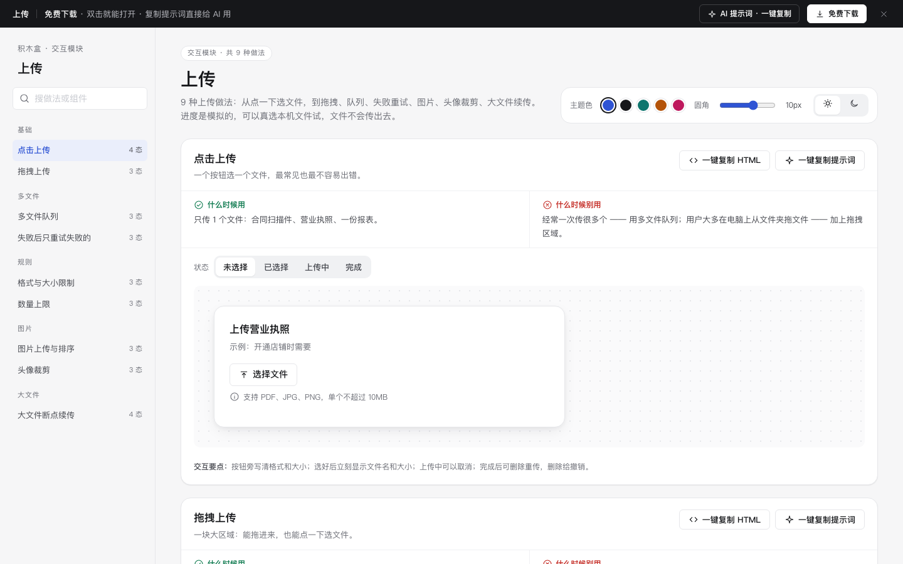

# 上传 · 交互模块

免费下载 · 双击就能打开 · 复制提示词直接给 AI 用。

> 积木盒 · 老岳AI编辑部 · 原型组　|　交互模块（组件 → **模块** → 页面模板）　|　单文件 HTML，离线可用　|　2026-11-10

这一页收了 9 种能点的上传做法：点击、拖拽、多文件队列、失败重试、格式大小限制、图片、头像裁剪、大文件续传、数量上限。进度是模拟的，可以真选本机文件试，文件不会传出去。

---

## 一、用处

| 项 | 说明 |
|---|---|
| 解决什么 | 上传最容易漏的是「中间」和「出错」：传到一半能不能取消，失败了要不要全部重传，格式不对什么时候说。这里每种做法都把这些状态摆出来了 |
| 适合谁 | 要画资料提交、商品发布、报销、资质审核、头像设置这类页面的产品经理 |
| 和页面模板的关系 | 页面模板是整页；模块是其中一块的多种做法，拼页面时从这里挑 |

## 二、做法清单

| # | 做法 | 状态 | 什么时候用 | 什么时候别用 |
|---|---|---|---|---|
| 1 | 点击上传 | 未选择 / 已选择 / 上传中 / 完成 | 只传 1 个文件 | 经常一次传很多个 |
| 2 | 拖拽上传 | 默认 / 拖入高亮 / 上传中 | PC 上从文件夹拖多个文件 | 只在手机上用 |
| 3 | 多文件队列 | 上传中 / 部分失败 / 全部完成 | 一次传 3 个以上 | 永远只传 1 个 |
| 4 | 失败后只重试失败的 | 有失败 / 重试中 / 全部成功 | 网络不稳时批量上传 | 别让用户「全部重传」 |
| 5 | 格式与大小限制 | 默认 / 格式不对 / 超过大小 | 有格式、大小要求 | 别等传到 99% 才说格式不对 |
| 6 | 图片上传与排序 | 空 / 有图 / 已满 9 张 | 图片本身就是内容（商品图） | 图片只是凭证，用文件队列 |
| 7 | 头像裁剪 | 选图 / 裁剪中 / 已设置 | 头像、Logo 这类固定比例的小图 | 商品图、证件照 |
| 8 | 大文件断点续传 | 上传中 / 网络中断已暂停 / 恢复续传 / 完成 | 单个文件超过 100MB | 小文件 |
| 9 | 数量上限 | 未满 / 已满 / 一次选多了 | 有数量限制的上传 | 别因为超出就整批拒收 |

## 三、用法

1. 下载文件夹，双击 `index.html`。
2. 左侧目录点到想要的做法，点「状态」切换；演示区能真实操作（选文件、拖文件、取消、重试、排序、缩放）。
3. 右上角换主题色、圆角、明暗，所有演示实时跟着变。
4. **一键复制 HTML**：复制当前状态的 HTML，自带所需 CSS 变量和样式，粘进任意 HTML 原型就能显示（交互逻辑用提示词让 AI 补）。
5. **一键复制提示词**：每种做法一条，交给 AI 就能做出带全部状态的同款。

### 页面上的 AI 提示词

页面顶部「AI 提示词 · 一键复制」里有 3 条，高亮的变量点一下就能就地填写，复制出来就是填好的完整提示词：

| # | 提示词 | 什么时候用 |
|---|---|---|
| 1 | 从零生成整套「上传」交互模块 | 想要一份自己的上传规范 + 演示 |
| 2 | 把上传改成我的业务（变量：做法、业务名称、角色、格式与大小、数量上限、上传后的流程） | 已经下载，换成自己的文件要求 |
| 3 | 在此基础上加一种做法 / 状态（变量：要加的做法、状态清单） | 模块里没有你要的做法 |

## 四、交互说明

| 做法 | 元素 | 交互 | 反馈 |
|---|---|---|---|
| 点击上传 | 选择文件 | 打开真实的文件选择框（限 PDF/JPG/PNG） | 立刻显示文件名、大小和进度；上传中可取消；完成后删除给撤销 |
| 拖拽上传 | 拖拽区域 | 文件拖进来 / 拖出去 / 松手；也能点、能 Tab 后回车 | 拖入时边框变主色、轻微放大、文案变「松手开始上传」；松手后进入队列 |
| 多文件队列 | 每行文件 | 同时最多传 3 个，其余「等待中」；单个取消 | 底部实时「已完成 N / 共 M」；结束后汇总成功几个、失败几个 |
| 失败重试 | 重试失败的 N 个 | 点击 | 只重传失败的；成功的不动；能重试的给「重试」，不能的只给「移除」并说怎么办 |
| 格式与大小 | 选择文件 | 选错格式或超大小 | 文件不进队列；区域变红，写「哪里不对 + 怎么办」，3 秒后恢复可直接重选 |
| 图片上传 | 缩略图 | 悬停或 Tab 聚焦出现预览 / 左移 / 右移 / 删除 | 第 1 张标「封面」；移到第 1 张提示「已设为封面」；删除 4 秒内可撤销；满 9 张时添加置灰 |
| 图片上传 | 预览弹窗 | 上一张 / 下一张；Esc、点遮罩关闭 | 显示「第 N / 共 M 张」 |
| 头像裁剪 | 缩放滑块 | 拖动或键盘左右键 | 圆框内图片实时缩放；确定后头像立刻更新，不再多一个保存按钮 |
| 断点续传 | 暂停 / 继续上传 | 断网自动暂停；点继续 | 写清已传多少、从断点继续；显示预计剩余时间 |
| 数量上限 | 添加 | 一次选的超过剩余名额 | 收下名额内的，其余列出文件名并说明；已满时按钮写「删掉一个才能再加」 |
| 全页 | 主题色 / 圆角 / 明暗 | 切换 | 所有演示实时变化，记在本机 |

## 五、自检（按《交互设计规范》）

- [x] 每种做法：上传中、失败、完成等状态齐全，可切换
- [x] 每种做法写清「什么时候用 / 什么时候别用」
- [x] 限制写在选文件之前；出错文案写「哪里不对 + 怎么办」
- [x] 可点元素 ≥ 32px；拖拽区可用键盘打开；焦点框清晰；文字对比度 ≥ 4.5:1（浅色、深色都检查）
- [x] 页面上有 3 条 AI 提示词，变量可就地填写，复制有成功反馈
- [x] 无 JS 报错（9 种做法 29 个状态 + 复制 HTML / 提示词 + 明暗切换 + 拖入、选错文件、队列重试、排序撤销、预览、裁剪、续传、名额脚本走查）
- [x] 示例文件名标「示例」，无真实公司名

---

本模块由老岳AI编辑部·原型组制作，免费下载、修改、用于工作项目。
