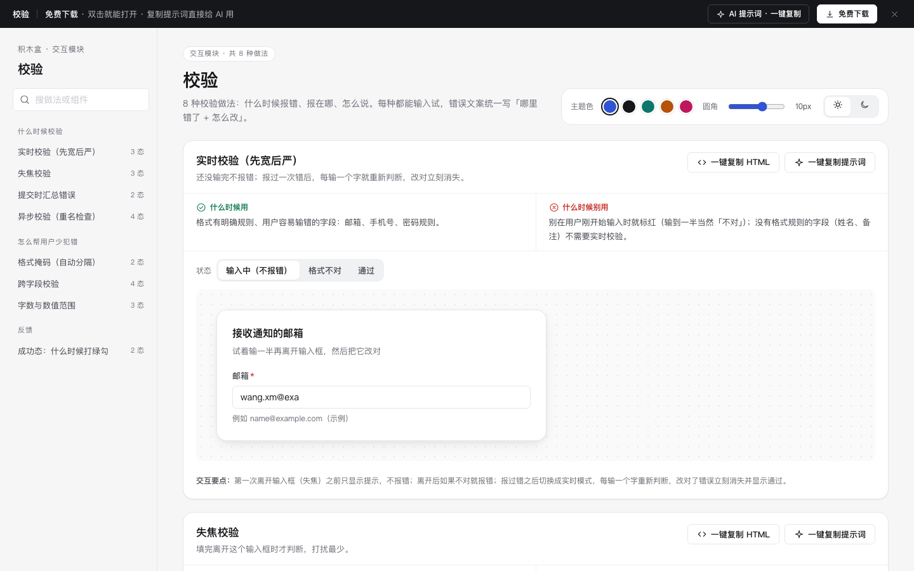

# 校验 · 交互模块

免费下载 · 双击就能打开 · 复制提示词直接给 AI 用。

> 积木盒 · 老岳AI编辑部 · 原型组　|　交互模块　|　单文件 HTML，离线可用　|　2026-11-10

这是一页能输入试的校验做法合集，共 8 种做法、23 个状态。它讲清三件事：什么时候报错、报在哪、怎么说。错误文案统一写成「哪里错了 + 怎么改」。

---

## 一、用处

| 项 | 说明 |
|---|---|
| 适合什么需求 | 写 PRD 时要定每个字段的校验规则和错误文案；评审时研发问「什么时候提示」「提示什么」 |
| 解决哪一步 | 拿字段表对着这页选做法，错误文案照着格式写，不再出现「格式错误」「非法输入」 |
| 和表单模块的关系 | 表单模块管「怎么排、怎么提交」，这里管「填错了怎么办」，两个配合用 |

**做法清单**

| # | 做法 | 状态 | 什么时候用 |
|---|---|---|---|
| 1 | 实时校验（先宽后严） | 输入中（不报错）/ 格式不对 / 通过 | 邮箱、手机号、密码等有格式规则的字段 |
| 2 | 失焦校验 | 默认 / 离开后报错 / 改对后 | 大多数普通字段的默认做法 |
| 3 | 提交时汇总错误 | 默认 / 提交后 | 长表单，用户可能漏填看不到的字段 |
| 4 | 异步校验（重名检查） | 默认 / 检查中 / 可以使用 / 已被占用 | 用户名、店铺名、编码等必须唯一的字段 |
| 5 | 格式掩码（自动分隔） | 默认 / 已输入 | 手机号、银行卡、金额、日期 |
| 6 | 跨字段校验 | 正常 / 结束早于开始 / 两次密码不一致 / 合计对不上 | 字段之间要对得上 |
| 7 | 字数与数值范围 | 正常 / 接近上限 / 超出 | 有长度或大小上下限的字段 |
| 8 | 成功态：什么时候打绿勾 | 对比 / 试一下 | 决定哪些字段通过时给反馈 |

## 二、用法

1. 下载整个文件夹，双击 `index.html`，不用联网。
2. 左侧目录点到想看的做法，在「状态」那一排切换，也可以直接在演示里输入。
   - 异步校验：输入「青禾小馆」或「南岸咖啡」会模拟名字已被占用。
   - 格式掩码：直接粘贴带空格或横杠的号码试试。
3. 每种做法右上角有两个按钮：
   - **一键复制 HTML**：复制当前状态的代码，自带所需的 CSS 变量、样式和图标。注意只复制外观，交互逻辑要用提示词让 AI 补上。
   - **一键复制提示词**：让 AI 按同样的状态和规则重新做一份。
4. 顶部可以换主题色、圆角和深浅色。

### 页面上的 AI 提示词

点页面顶部的「AI 提示词 · 一键复制」，有 3 条提示词：

| # | 提示词 | 什么时候用 |
|---|---|---|
| 1 | 从零生成整套「校验」交互模块 | 想要一份自己的校验规范，加一个能点的演示 |
| 2 | 按我的字段生成校验规则和文案 | 带变量：表单名称、角色、字段列表。AI 先给方案表，再改演示 |
| 3 | 在此基础上加一种校验做法 / 状态 | 例如上传文件校验、身份证号校验、批量导入逐行校验 |

提示词里高亮的变量，点一下就能填；复制出来的是填好变量的完整提示词。

## 三、交互说明

| 做法 | 触发时机 | 错误文案示例 | 反馈 |
|---|---|---|---|
| 实时校验 | 第一次离开输入框之前不报错，报过错之后每输一个字就重新判断 | 「邮箱后面少了域名后缀，例如 .com」 | 改对后错误立刻消失，并出现绿勾 |
| 失焦校验 | 离开输入框时判断，回来改对时立刻消失 | 「手机号少了 4 位，应为 11 位数字」 | 边框变红，下方出现图标和文字 |
| 提交汇总 | 点「保存」时检查所有字段 | 「税号：现在是 7 位，应为 18 位数字或大写字母」 | 顶部列出所有错误，点一条就跳到对应字段；改对一项，列表里就少一项 |
| 异步校验 | 停止输入 0.5 秒后检查，只认最后一次请求的结果 | 「『南岸咖啡』已被其他店铺使用，换一个或用下面的推荐」 | 检查中输入框转圈；可用时打绿勾；名字被占用时给 3 个推荐名，点一下就填入 |
| 格式掩码 | 输入时 | — | 自动加分隔符，光标不乱跳；金额离开时补齐两位小数；下方显示提交时实际取的值 |
| 跨字段 | 任一相关字段变化时 | 「结束日期不能早于开始日期（11-20），请改成 11-20 之后」 | 错误标在后填的那个字段上；合计对不上时直接写差多少，并给「用合计填入」按钮 |
| 字数范围 | 输入时 | 「超了 10 个字，请删减到 60 字以内」「最多 99 件，现在是 150，可改成 99」 | 计数器到 80% 变橙、超出变红；超出时不截断用户输入 |
| 成功态 | 通过时 | — | 有对错、用户又关心的字段才打绿勾；姓名、备注这类没有对错的字段通过时保持安静 |

## 四、自检（按《交互设计规范》）

- [x] 8 种做法共 23 个状态都能切换，演示都能直接输入
- [x] 错误文案全部写成「哪里错了 + 怎么改」；错误不只靠红色表达，同时有图标和文字，并设置了 aria-invalid
- [x] 不截断用户输入；能自动整理的内容（分隔符、千分位、补齐小数）由系统处理
- [x] 文字对比度 ≥ 4.5:1，焦点框清晰
- [x] 示例数据标了「示例」，没有出现真实品牌
- [x] 无 JS 报错：全部状态逐个切换，复制 HTML、复制提示词、暗色主题都检查过
- [x] 关键交互用脚本走过一遍：实时校验先宽后严、失焦后修正、汇总后跳转、重名检查后选推荐名、四种掩码、跨字段一键修正、超出字数、绿勾

---

本模块由老岳AI编辑部·原型组制作，免费下载，可以修改，也可以用在工作项目里。

状态：已通过浏览器验收（1440/1024/500/390 宽 0 报错、0 溢出、对比度与触控达标；标准外壳与跨目录比对通过）
