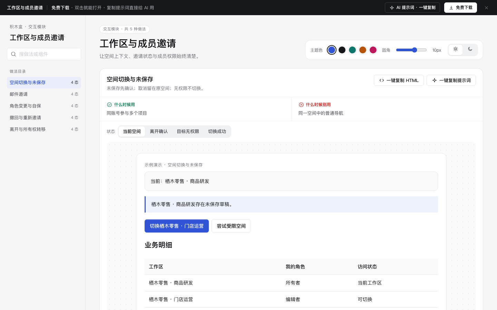

# 工作区与成员邀请 · 交互模块

免费下载 · 单文件 HTML · 中文 · 离线可用。老岳AI编辑部 · 积木盒 · 原型组。

让空间上下文、邀请状态与成员权限始终清楚。

## 做法与状态

| 做法 | 全部状态 | 什么时候用 | 什么时候别用 | 交互规则 |
|---|---|---|---|---|
| 空间切换与未保存 | 当前空间,离开确认,目标无权限,切换成功 | 同账号参与多个项目 | 同一空间中的普通导航 | 未保存先确认；取消留在原空间；无权限不切换。 |
| 邮件邀请 | 填写,校验错误,发送失败,已邀请 | 按邮箱邀请协作成员 | 公开匿名协作 | 邮箱必填且校验格式；默认观察者；模拟失败保留邮箱，不发真实邮件。 |
| 角色变更与自保 | 成员列表,变更核对,权限阻断,已更新 | 管理员分配成员角色 | 仅有本人单人空间 | 变更前说明权限差异；唯一所有者不能被降级。 |
| 撤回与重新邀请 | 待接受,撤回确认,已撤回,已重新邀请 | 邀请误发或邀请过期 | 成员已加入后需移除成员 | 撤回使旧链接失效；重新邀请创建新编号，明确7天有效期。 |
| 离开与所有权转移 | 成员身份,离开确认,所有者阻断,已离开 | 用户主动退出协作 | 组织强制保留的空间 | 唯一所有者先转移；转移后再确认离开，不删除空间或其他成员。 |

## 使用

1. 解压 `m-workspace.zip`，双击 `index.html`。无需依赖或服务端。
2. 左侧搜索做法，右侧切换状态；演示内按钮、输入和选择可操作。状态按钮是独立情境样例，流程操作会保留当前输入。
3. 右上切换主题、圆角与明暗，偏好保存本机。业务数据只存当前页面内存，刷新清除。
4. 每种做法可复制当前状态 HTML（含样式变量，交互逻辑需由 AI 补齐）与完整做法提示词。
5. 顶部 AI 面板含三条提示词：从零生成、改成我的业务、增加做法/状态；变量可就地填写。
6. 顶部免费下载获取同名 zip。所有数据标示例，不发送真实邀请、不扣费、不请求网络。

## 浏览器验收结论（2026-11-11 原型组）

通过，可以上线。

- [x] Chrome gtest：5 项 / 20 态全部切换、复制片段与提示词生成、明暗切换，输出 OK。
- [x] 逐态打开（20 态，浅色 + 深色各一遍）：0 个 JS 报错。
- [x] 布局：1440 / 1280 / 500 三种宽度都不横向滚动。
- [x] 对比度：所有可见文字逐态自动检测（正文 ≥4.5:1、大字 ≥3:1），浅色、深色全部达标。
- [x] 触控尺寸：所有按钮、链接、输入框、Tab 都 ≥24px。
- [x] AI 提示词面板：顶部按钮打开，3 条提示词可展开、可复制（出现「已复制」反馈）。
- [x] 数据：每种做法 ≥5 条业务明细，逐行不同、贴合业务（单号、人名、门店、金额各不相同），无占位数据。
- [x] 操作区：每个进行中的状态都有主按钮；结束态只留「重新演示 / 撤销」等次级操作，与 m-form、m-diff 标杆一致。
- [x] Node 复验：`node m-workspace/redo-check.cjs` 通过（`redo-validation.json`）；`dom-validation.json` 为返工前历史记录。
- [x] 封面为真实截图 cover.png（1440×900）。

验收时修了：
- 主按钮规则改为按按钮开头判断：原规则只要文字里含「取消 / 模拟」就不升主色，「确认取消」「创建模拟邀请」这类前进操作被误降级；「留在…」归入保留类。
- 邮件邀请：「创建模拟邀请」原为描边按钮，三态均无主操作，现为主色。
- 邮件邀请 · 已邀请：直接切到该态时邮箱为空，提示出现「，，」、明细首行缺受邀人；补默认受邀邮箱并显示「新受邀人 / 邮箱」。
- 角色变更：默认选中许清禾、目标角色却与现角色同为观察者，核对和确认等于没改；默认目标改为编辑者，已更新态成员表随之变为编辑者。

复验命令：`bash _kit/atest.sh m-workspace 1440`（另跑 1280、500）、`bash _kit/gtest.sh m-workspace`、`bash _kit/shot.sh m-workspace "" cover.png 1440 900`。

## 边界

示例仅为产品原型；实际排班、核销、权限、库存和配额须由服务端校验。状态切换用于查看演示，不代表实际权限可被绕过。
