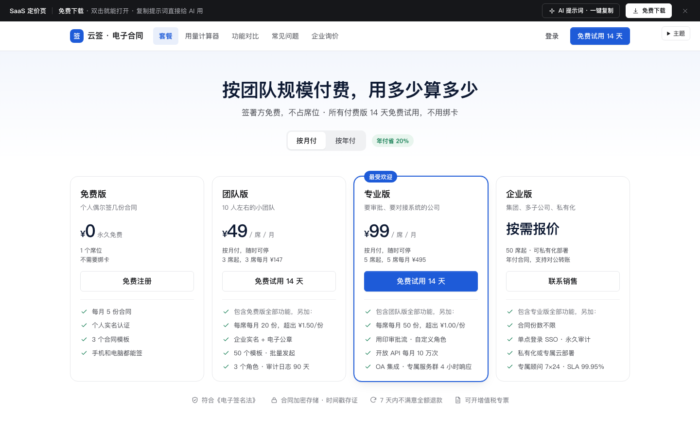

# SaaS 定价页（套餐 · 用量计算器 · 功能对比 · FAQ · 企业询价）

免费下载 · 双击就能打开 · 复制提示词直接给 AI 用。

> 积木盒 · 老岳AI编辑部 · 原型组　|　PC 1440（500 宽不横滚，宽表在卡片内滚动）　|　单文件 HTML，离线可用　|　2026-11-11 重做

电子合同 SaaS「云签」（示例产品）的官网定价页，一页从上到下：套餐卡（月付 / 年付、已登录时标当前套餐并按天补差价升级）→ 用量计算器（按席位 + 合同份数逐个套餐算钱，推荐最省的、算出分界点）→ 功能对比（分组、只看差异、问号说明）→ 常见问题（搜索高亮）→ 企业询价表单（校验、防重复、成功 / 失败）。所有价格由 `DATA` 算出，精确到分。顶部吸顶导航与「原型面板」都能直达各区块。

---

## 一、用处

| 项 | 说明 |
|---|---|
| 适合什么需求 | 按席位 / 按用量计费的 SaaS 官网定价页、产品内「升级套餐」页 |
| 解决哪一步 | 评审常问的都能点：年付到底便宜多少、不足最少席位怎么算、超出配额怎么收费、哪个套餐最省、什么时候该换高一档、中途升级补多少钱、降级什么时候生效、个人邮箱能不能询价 |
| 不适合 | 支付收银台（见 `c-checkout`）；团队成员与权限管理（见 `saas-settings`） |

**页面和状态**（右下角「原型面板」切换，切换后自动滚到对应区块）

| 页面 | 状态 |
|---|---|
| ① 套餐与价格 | 按月付（未登录）/ 按年付 / 已登录 · 团队版 5 席 / 加载中 / 价格加载失败 |
| ② 用量计算器 | 8 席 · 300 份 / 220 席 → 建议询价 / 1 人 · 3 份 → 免费版 / 要审批流 → 专业版 |
| ③ 功能对比 | 全部 17 项 / 只看差异 |
| ④ 常见问题 | 正常 / 搜索「退款」/ 搜不到 |
| ⑤ 企业询价 | 空表单 / 校验出错 / 已提交 / 提交失败 |

## 二、用法

1. 双击 `index.html`；右下角「原型面板」切页面和状态，按 `H` 隐藏；直达例：`#page=calc&state=enterprise`。
2. 改数据只改 `<script>` 顶部 `DATA`：`plans` 套餐（每席月价、最少 / 最多席位、每席含量、超出单价、亮点）；`yearOff` 年付折扣；`cycle` / `current` 已登录用户的账单周期与当前套餐；`compare` 功能对比（`true` 有、`''` 没有、文字为具体值，第 7 列是说明）；`faq`；`freeMail` 个人邮箱后缀；`sizes` 公司规模。
3. 改颜色：`:root` 的 `--accent`。
4. 页面顶部「AI 提示词」3 条：从零生成（写明计费公式、分界点、状态）/ 改成我的业务（变量：产品、计费单位、价格、年付折扣、含量规则、对比分组）/ 加页面或状态（优惠码、阶梯价、多币种、下单确认页）。

## 三、交互说明

| 元素 | 交互 | 反馈 |
|---|---|---|
| 月付 / 年付 | 切换（顶部与计算器同步） | 年付卡片显示折后每席月价、划掉原价、写「按年付 ¥470.40 / 席，省 ¥117.60」和最少席位一年多少钱；对比表表头价格同步 |
| 套餐卡 | 免费注册 / 免费试用 / 联系销售 | 每屏只有专业版一个主按钮；试用弹窗写清试用范围、不绑卡、到期转免费版 |
| 已登录 | 升级 / 降级 | 标「当前套餐 · 5 席」；升级弹窗列出现在 → 升级后、本期剩余 20 / 30 天、今天补差价 ¥166.67 及算式；降级写清本期结束后生效、不退差价，降到免费版要先减到 1 席 |
| 计算器输入 | 席位滑块 + 步进（1～200）、合同份数（0～5000，步进 50）、需要的能力 | 改任何一项，下方每个套餐的计费席位、席位费、包含份数、超出费、合计即时重算 |
| 推荐 | — | 选最便宜且满足需求的套餐，写算式、比次优省多少、改年付每年省多少；同席位下合同达到多少份起专业版更省（逐份试算）；不满足的套餐写原因（最多 50 席 / 不含审批流）；超过 100 席或要 SSO 推荐询价 |
| 功能对比 | 只看差异、问号 | 17 项分 5 组；只看差异时隐藏 4 家都一样的项；首列吸附、专业版列高亮 |
| 常见问题 | 搜索、展开 | 搜索时匹配项全部展开并高亮关键词；搜不到给清空和问客服 |
| 企业询价 | 填写、提交 | 公司全称、联系人、11 位手机（自动去掉非数字）、工作邮箱（个人邮箱黄字提示）、规模必填；出错就地报错并聚焦第一项；提交中按钮禁用防重复；成功写联系时间、打码手机号、工单号；失败保留已填内容可重试 |

## 四、验收结论（2026-11-11 原型组）

**通过。** 对照上轮打回原因：上轮是通用表单与列表骨架，没有真实的计费规则、年月付联动和计算。本次：

| 方面 | 本次 |
|---|---|
| 计费真实 | 4 档套餐各有单价、最少 / 最多席位、含量、超出单价；年付 8 折、升级按天补差价、超出按月结算不打折，全部由数据算出 |
| 系统替人算 | 计算器逐个套餐算总价并推荐最省、给出分界点（8 席时 481 份起专业版更省），不让用户心算 |
| 内容密度 | 17 项功能对比含说明、9 条 FAQ 均为具体规则与例子、4 条企业版卖点 |
| 全状态 | 18 个状态：已登录、加载、出错、建议询价、免费版就够、只看差异、搜不到、校验出错、已提交、提交失败 |

机器验收：`_kit/atest.sh` 1440 / 1280 / 500 宽 × 18 个状态：0 JS 报错、0 横滚、0 对比度问题、0 小于 24px 的可点元素；提示词面板可打开 / 展开 / 填变量 / 复制。交互断言 28 条在无头 Chrome 通过（套餐卡与最少席位价、年付折算、计算器跟随年付、默认推荐与算式、分界点、份数变化换推荐、席位步进、不足最少席位、审批流需求、SSO 询价、免费版推荐、只看差异、问号说明、FAQ 搜索高亮与搜不到、手风琴、询价必填、手机号清洗、个人邮箱提示、提交防重复与成功、当前套餐、升级补差价与生效、降级提示、提交失败保留内容、220 席询价、出错重试）。`gtest.sh` 面向组件画廊，页面模板不适用，以交互断言代替。

---

本模板由老岳AI编辑部·原型组制作，可免费下载、修改、用于工作项目。

状态：已通过浏览器验收（1440/1024/500/390 宽 0 报错、0 溢出、对比度与触控达标；标准外壳与跨目录比对通过）
