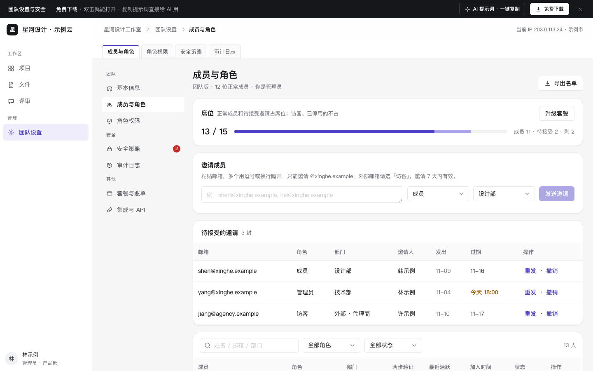

# 团队设置与安全（成员席位 · 角色权限 · 安全策略 · 审计日志）

免费下载 · 双击就能打开 · 复制提示词直接给 AI 用。

> 积木盒 · 老岳AI编辑部 · 原型组　|　PC 1440（500 宽不横滚）　|　单文件 HTML，离线可用　|　2026-11-11 重做

SaaS 产品最常见的「团队设置」，以设计团队协作工具为例，当前登录人是管理员（不是所有者）：成员与席位（批量邀请逐个识别、席位计算、角色限制、停用移除与项目交接）、角色权限矩阵（固定权限写原因、改动高亮）、安全策略（两步验证宽限、密码规则、IP 白名单防自锁、SSO、外部分享、水印，保存要验证码）、审计日志（失败标红、详情、所有改动自动记录）。框架复用 `b-shell`（侧栏、顶栏面包屑、页签），设置页内再有二级导航。

---

## 一、用处

| 项 | 说明 |
|---|---|
| 适合什么需求 | 任何多人协作的 SaaS / 后台：工作区设置、成员管理、权限、安全合规、操作日志 |
| 解决哪一步 | 评审常问的都能点：席位怎么算、外部的人怎么邀请、管理员能不能改所有者、离职的人负责的项目怎么办、哪些权限不能开、IP 白名单填错了会不会把自己锁外面、改安全策略要不要二次验证、谁什么时候改了什么 |
| 不适合 | 套餐购买与账单（见 `saas-pricing`）；企业组织架构与审批人配置（见 `b-rbac`） |

**页面和状态**（右下角「原型面板」切换）

| 页面 | 状态 |
|---|---|
| ① 成员与角色 | 正常（13 人 · 13/15 席）/ 席位已满 / 空（只有自己）/ 加载中 / 加载失败 / 无权限（成员视角） |
| ② 角色权限 | 正常 / 空（无自定义角色）/ 加载中 / 加载失败 / 无权限 |
| ③ 安全策略 | 正常 / 会把自己锁在外面 / 空（未设置）/ 加载中 / 加载失败 / 无权限 |
| ④ 审计日志 | 正常（14 条）/ 空 / 加载中 / 加载失败 / 无权限 |

## 二、用法

1. 双击 `index.html`；右下角「原型面板」切页面和状态，按 `H` 隐藏；直达例：`#page=security&state=lockout`。
2. 改数据只改 `<script>` 顶部 `DATA`：`org` 团队、套餐席位、公司域名、当前 IP、演示验证码；`members` 成员；`invites` 待接受邀请；`perms` 权限矩阵（2 固定开、-1 固定关）；`sec` 安全策略当前值；`logs` 审计日志。
3. 改颜色：`:root` 的 `--accent`（默认靛紫）。
4. 页面顶部「AI 提示词」3 条：从零生成 / 改成我的业务（变量：产品和团队、角色、套餐席位、安全策略、日志类型）/ 加页面或状态（转让所有者、离职交接、SCIM 同步、会话管理）。

## 三、交互说明

| 元素 | 交互 | 反馈 |
|---|---|---|
| 席位 | — | 用量条分「成员」「待接受」两段；正常成员 + 非访客邀请占席位，访客和已停用不占；满了顶部红条给「升级套餐」 |
| 批量邀请 | 粘贴多个邮箱（逗号 / 换行） | 逐个变标签：格式不对、已是成员（红）；已邀请过、外部邮箱只能邀访客（黄）；超出剩余席位的标「席位不够」；按钮写「发送 N 封邀请」，只发通过的 |
| 待接受邀请 | 重发 / 撤销 | 今天过期标黄；重发延长 7 天；撤销释放席位 |
| 改角色 | 行内下拉 | 二次确认写清新角色能做什么；所有者和自己的角色不能改（悬停写原因）；席位满时访客不能升为成员 |
| 停用 / 恢复 | 点击 | 停用二次确认，立即下线、释放席位；恢复时检查席位 |
| 移除 | 右侧抽屉 | 有负责项目时必须指定接收人，并输入姓名确认 |
| 权限矩阵 | 点格子 | 固定格子置灰，悬停写原因（所有者固定拥有 / 访客是外部协作者 / 需提升为管理员）；改过的格子黄框；底部「有 N 处修改」+ 撤销 / 保存（二次确认） |
| 两步验证 | 开关 + 宽限期 | 列出还没开的人和截止日，可一键提醒 |
| 密码规则 | 长度、必须包含、有效期 | 长度 8～32 校验 |
| IP 白名单 | 每行一条 IP / 网段 | 校验格式；实时提示当前 IP 是否在名单内；不在时红条「保存后你会被锁在外面」并禁用保存，给「把当前 IP 加进白名单」 |
| SSO | 开关 + 元数据地址 | 开启时必须填 https 地址 |
| 外部分享 | 禁止 / 需要密码 / 允许 | 选禁止时写「已存在的 23 个外部链接会立即失效」 |
| 保存安全策略 | 点保存 | 改过的行高亮；弹 6 位验证码（演示 246810），输错提示剩余次数，自动跳格；成功后每项改动写进审计日志 |
| 审计日志 | 类型、操作人、只看失败 | 修改前 → 修改后；失败行标红；点一行抽屉看详情和请求编号，失败登录给处理建议 |
| 未保存离开 | 切到别的页面 | 角色权限、安全策略有改动时先确认 |

## 四、验收结论（2026-11-11 原型组）

**通过。** 对照上轮打回原因逐条处理：

| 上轮问题 | 本次 |
|---|---|
| 数据批量复制（「陈示例2…10」） | 13 位成员邮箱、部门、两步验证、最近活跃各不相同；3 封邀请、14 条审计日志逐条写实；席位数由数据算出 |
| 通用「筛选 + 表格 + 详情」骨架 | 席位计算、批量邀请识别、角色限制、移除交接、权限矩阵、防自锁、二次验证、审计联动，均为团队设置专属 |
| 提示词套话 | 3 条写明席位规则、角色限制、防自锁、二次验证、审计记录 |
| 勾选框 13px、输入框 20～22px | 权限格子 28px；表格内下拉 32px；勾选框外包 28px 点击区 |

机器验收：`_kit/atest.sh` 1440 / 1280 / 500 宽 × 22 个状态：0 JS 报错、0 横滚、0 对比度问题、0 小于 24px 的可点元素；提示词面板可打开 / 展开 / 复制。交互断言 24 条通过（席位 13/15、5 种邮箱识别、只发剩余席位数、发送后满席、访客不占席位、撤销释放席位、所有者和自己不可改、改角色确认、移除交接校验、移除成功、停用、固定权限、权限改动计数、未保存离开确认、日志按类型 / 失败筛选、失败详情、两步验证未开人数、防自锁拦截、加入当前 IP、密码长度校验、验证码错误、验证后保存、改动写入审计日志）。`gtest.sh` 面向组件画廊（Gallery），页面模板不适用，以交互断言代替。

---

本模板由老岳AI编辑部·原型组制作，可免费下载、修改、用于工作项目。
