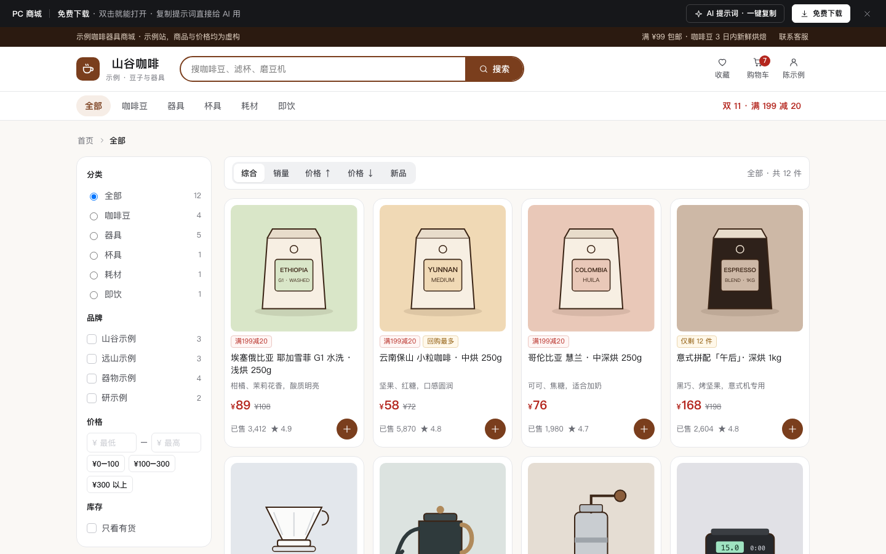

# PC 商城（列表筛选 + 规格联动库存 + 购物车算价 + 结算）

免费下载 · 双击就能打开 · 复制提示词直接给 AI 用。

> 积木盒 · 老岳AI编辑部 · 原型组　|　PC 1440（500 宽不横滚）　|　单文件 HTML，离线可用　|　2026-11-11 重做

以精品咖啡豆与器具小店为例的 PC 独立商城：顶部搜索（联想 + 热搜）、分类导航、列表筛选排序、商品详情（重量 × 研磨联动库存、限购、按地址算送达和运费、评价筛选）、购物车（满减进度、自动选券、失效商品、未登录合并）、确认订单（地址 / 配送 / 发票校验 / 支付）。12 个商品图都是内联 SVG 插画（豆袋、滤杯、手冲壶、磨豆机、电子秤…），不用占位字。

---

## 一、用处

| 项 | 说明 |
|---|---|
| 适合什么需求 | 品牌官网商城、垂直品类独立站、B2C 小店的 PC 端 |
| 解决哪一步 | 评审常问的都能点：某个规格组合没货怎么显示、数量上限是库存还是限购、满减和券先算哪个、差多少能凑单、失效商品怎么办、未登录加的购物车登录后怎么合并、单位发票要校验什么、下单时库存变了怎么办 |
| 不适合 | 手机端下单链路（见 `c-checkout`）；商城首页运营位（见 `c-mall-home`）；商家后台（见 `b-mall-admin`） |

**页面和状态**（右下角「原型面板」切换）

| 页面 | 状态 |
|---|---|
| ① 商品列表 | 正常（12 件）/ 搜索无结果 / 加载中 / 加载失败 |
| ② 商品详情 | 正常（规格联动库存）/ 整款售罄（到货提醒）/ 评价 Tab / 加载中 / 加载失败 |
| ③ 购物车 | 正常（含失效商品）/ 空 / 未登录（登录后合并）/ 加载中 / 加载失败 |
| ④ 确认订单 | 正常 / 单位发票校验出错 / 库存变化 / 提交中 / 下单成功 / 加载中 |

## 二、用法

1. 双击 `index.html`；右下角「原型面板」切页面和状态，按 `H` 隐藏；直达例：`#page=cart&state=guest`。
2. 改数据只改 `<script>` 顶部 `DATA`：`goods` 商品（最后两位是插画类型和底色、库存）、`sku` 规格与库存表、`addrs` 地址与送达日 / 偏远加价、`reviews` 评价、`cart` / `dead` 购物车与失效商品、`cut` 满减档位、`coupons` 优惠券、`freeShip` / `ship` 运费规则。
3. 改颜色：`:root` 的 `--accent`（默认咖啡棕）和 `--price`。
4. 页面顶部「AI 提示词」3 条：从零生成 / 改成我的业务（变量：店铺和品类、分类、规格维度与库存、促销规则、运费、插画品类）/ 加页面或状态（周期购、商品对比、库存紧张、会员价）。

## 三、交互说明

| 元素 | 交互 | 反馈 |
|---|---|---|
| 搜索 | 聚焦 / 输入 / 回车 | 输入框和按钮同一行连成一体；聚焦显示最近搜过和热搜；输入时联想商品名（命中字加粗），↓ 键进入联想；回车出结果，无结果给替代关键词 |
| 筛选 | 分类、品牌、价格区间（可点快捷区间）、只看有货 | 已选条件成可删除标签，可「全部清除」；最低价大于最高价自动对调；窄屏收进「筛选」按钮 |
| 排序 | 综合 / 销量 / 价格升降 / 新品 | 即时重排 |
| 商品卡 | 点卡片进详情；点 ＋ 快捷加购 | 售罄卡片蒙层写到货日期，＋ 置灰；加购后顶部购物车数量变 |
| 规格 | 重量 × 研磨 | 无货组合虚线置灰写「无货」，点了提示原因；换重量后原研磨无货时自动换成有货的并提示；少于 10 件写「仅剩 N」 |
| 数量 | 步进器 / 直接输入 | 上限 = min(库存, 限购 5)，到上限时写是库存还是限购；输入超限自动改回上限并提示 |
| 配送地址 | 下拉选择 | 重算预计送达日；偏远地区写加价 |
| 加入购物车 / 立即购买 | 点击 | 同款同规格合并数量；立即购买只勾选这件进结算 |
| 整款售罄 | 「到货提醒我」 | 按钮变「已订阅到货提醒」 |
| 评价 | 全部 / 有图 / 好评 / 中差评 | 带买家图、商家回复 |
| 购物车勾选 | 单选 / 全选（只作用有效商品） | 合计实时变；一件没勾时「去结算」置灰写「先勾选商品」 |
| 满减进度 | — | 「已满 ¥199 减 ¥20；再买 ¥17 可减 50」+「去凑单」 |
| 优惠券 | 下拉 | 默认自动选最优；不满足门槛的置灰写「还差 ¥N」 |
| 改规格 | 点规格标签 | 右侧抽屉选规格，无货的不可选 |
| 删除 / 移入收藏 | 点击 | 删除 Toast 带「撤销」 |
| 失效商品 | 「清空失效商品」 | 二次确认；售罄的给「到货提醒」，下架的给「找相似」 |
| 未登录 | 「登录并合并」 | 本机 2 件并入账号购物车，同款数量相加 |
| 确认订单 | 地址 / 配送 / 发票 / 支付 / 备注 | 次日达 +¥12，远方地址不支持次日达；单位发票校验单位名称和 15～20 位税号；备注计数 |
| 库存变化 | 「改为 1 件并继续」 | 数量和金额重算 |
| 提交 | 点击 | 「正在提交…」后显示订单号、应付金额和「请在 14:50 前支付」（写截止时间，不做跳秒倒计时） |

**算价规则**：商品金额 → 先满减（满 399 减 50，否则满 199 减 20）→ 再用券（新人券满 100 减 15 按满减后金额判断；器具券按器具金额满 300 判断）→ 运费按商品金额满 99 包邮，否则 ¥8；次日达 +¥12、偏远 +¥12。示例：382 − 20 − 15 = 347；滤纸再加 1 件 → 407 − 50 − 15 = 342。

## 四、验收结论（2026-11-11 原型组）

**通过。** 对照上轮打回原因逐条处理：

| 上轮问题 | 本次 |
|---|---|
| 1440 宽搜索按钮被挤到输入框下方 | 输入框与按钮在同一个 flex 容器里连成一体，断言检查两者同一行 |
| 原型页切换当成网站导航 | 网站导航只放真实分类，页面切换只在原型面板里 |
| 分类重复后缀「/ 日常好物」 | 6 个分类名各自独立 |
| 商品图为单个汉字占位 | 12 个商品用 9 种内联 SVG 插画，底色、标签各不相同 |
| 提示词套话 | 3 条写明规格库存、上限来源、算价顺序、合并与库存变化边界 |

机器验收：`_kit/atest.sh` 1440 / 1280 / 500 宽 × 20 个状态：0 JS 报错、0 横滚、0 对比度问题、0 小于 24px 的可点元素；提示词面板可打开 / 展开 / 复制。交互断言 26 条通过（列表数量、角标、搜索按钮同行、热搜、联想、搜索结果、品牌 / 价格 / 有货筛选、排序、规格自动换、限购上限、库存上限、偏远运费、评价筛选、购物车合计 347、满 399 减 50 → 342、券可用性、不用券、删除撤销、全不选置灰、去结算、发票校验、次日达、下单成功）。`gtest.sh` 面向组件画廊（Gallery），页面模板不适用，以交互断言代替。

---

本模板由老岳AI编辑部·原型组制作，可免费下载、修改、用于工作项目。
